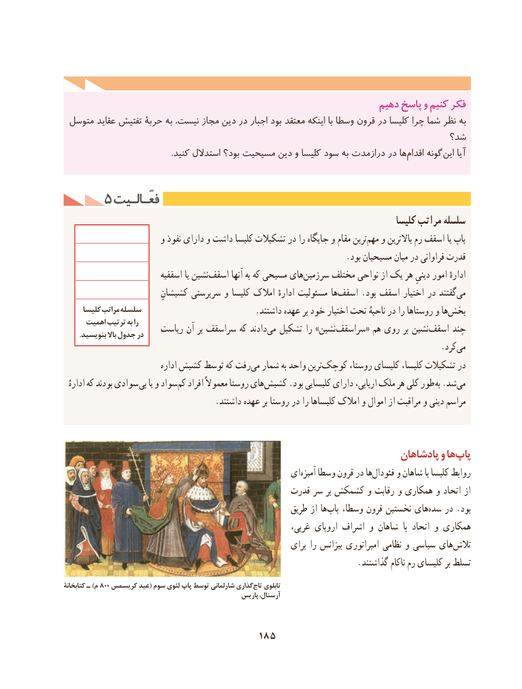

# PDF page 195

دهیمدهیم پاسخپاسخ وو کنیمکنیم فکرفکر
 متوسل عقاید تفتیش حربۀ به نیست، مجاز دین در اجبار بود معتقد اینکه با وسطا قرون در کلیسا چرا شما نظر به
                                                                    شد؟
 .‌کنید استدالل بود؟ مسیحیت دین و کلیسا سود به درازمدت در هااقدام گونه این آیا

     5 فعّـالـیتفعّـالـیت
                                                                                     کلیسا مراتب ‌سلسله
                       و نفوذ دارای و داشت کلیسا تشکیالت در را جایگاه و مقام ترین‌مهم و باالترین رم اسقف یا پاپ
                                                                    .بود مسیحیان میان در فراوانی قدرت
                           اسقفیه یا نشین ‌اسقف آنها به که ‌مسیحی های ‌سرزمین مختلف نواحی از یک هر دینیِ امور ادارهٔ
                         کشیشانِ سرپرستی و کلیسا امالک ادارهٔ مسئولیت هااسقف‌     .بود اسقف اختیار در گفتندمی‌
     كلیسا مراتب سلسله .‌داشتند عهده بر خود اختیار تحت ناحیۀ در را روستاها و هابخش
      اهمیت ترتیب به را                      ریاست آن بر سراسقف که دادندمی‌  تشکیل را »نشین‌سراسقف« هم روی بر نشیناسقف‌     چند         .بنویسید باال جدول در
                                          .‌کردمی
                              اداره کشیش توسط که رفت ‌می شمار به واحد ترینکوچک‌       روستا، کلیسای کلیسا، تشکیالت در
  ادارۀ که بودند سوادی بی یا و سواد ‌کم افراد معموالً روستا های ‌کشیش .بود کلیسایی دارای اربابی، ملک هر کلی طور  به .شد ‌می
                                    .داشتند عهده بر روستا در را کلیساها امالک و اموال از مراقبت و دینی مراسم

                                                                     پادشاهان و هاپاپ‌
                                               ای‌آمیزه وسطا قرون در ها‌فئودال و شاهان با کلیسا روابط
                                               قدرت سر بر کشمکش و رقابت و همکاری و اتحاد از
                                                       طریق از ها‌پاپ وسطا، قرون نخستین های‌سده در .بود
                                                           غربی، اروپای اشراف و شاهان  با اتحاد و همکاری
                                                            برای را بیزانس امپراتوری نظامی و سیاسی های‌تالش
                                                                      .گذاشتند ناکام رم کلیسای بر تسلط
کتابخانۀ ـ۸۰۰)م   کریسمس عید( سوم لئوي پاپ توسط شارلماني گذاري تاج تابلوی
                                                   پاریس آرسنال،

                                   185

