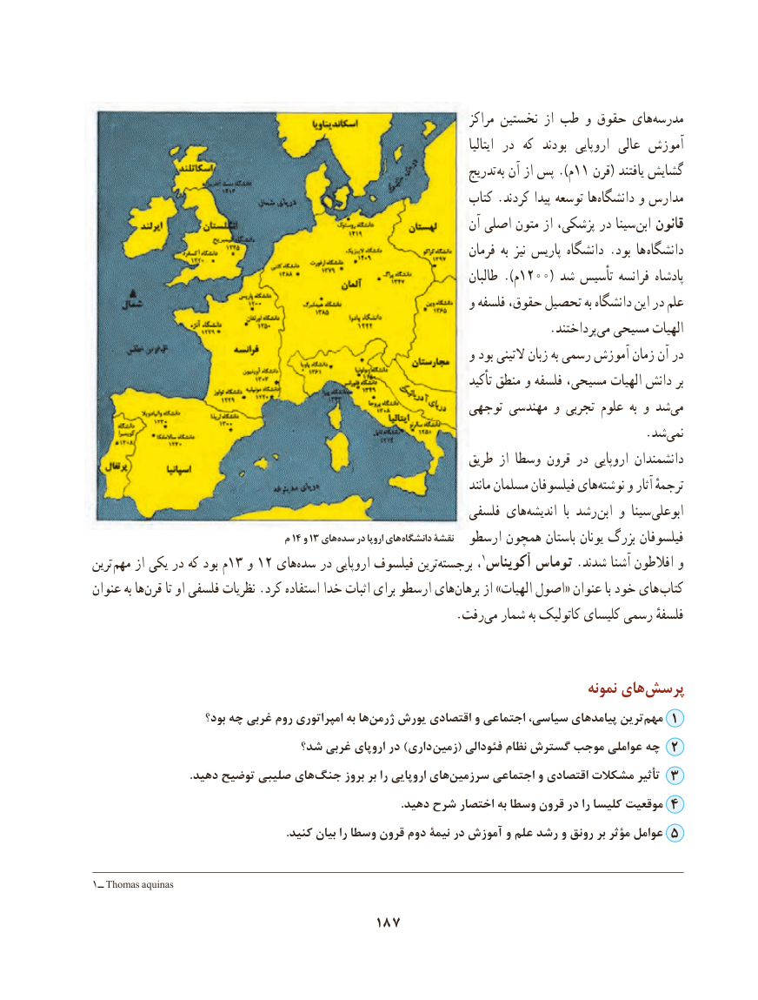

# PDF page 197

مراکز نخستین از طب و حقوق هایمدرسه‌
                                                                                                           ایتالیا در  که  بودند  اروپایی  عالی آموزش
                                                                     تدریج به آن از پس ).م11 قرن( یافتند گشایش
                                                               کتاب .کردند پیدا توسعه ها‌دانشگاه و مدارس
                                                                    آن اصلی متون از پزشکی، در سینا ابن قانون
                                                                        فرمان به نیز پاریس دانشگاه .بود ها  دانشگاه
                                                                              طالبان ).م1200( شد تأسیس فرانسه پادشاه
                                                              و فلسفه حقوق، تحصیل به دانشگاه این در علم
                  .‌پرداختندمی مسیحی الهیات‌
                                                              و بود التینی زبان به رسمی آموزش زمان آن در
                                                                                  تأکید منطق و فلسفه مسیحی، الهیات دانش بر
                                                        توجهی مهندسی و تجربی علوم  به و شد‌می
                                              .‌شدنمی
                                                               طریق از وسطا قرون در اروپایی دانشمندان
                                                                                       مانند مسلمان فیلسوفان های‌نوشته و آثار ترجمهٔ
                                                            فلسفی های ‌اندیشه  با رشد ابن و سینا ابوعلی
                                   م 14 و 13 های سده در اروپا های دانشگاه نقشۀ  ارسطو همچون باستان یونان بزرگ فیلسوفان
ترین  مهم از یکی در که بود م13 و 12 های‌سده در اروپایی فیلسوف ترینبرجسته‌        ، 1آکویناس توماس .شدند آشنا افالطون و
عنوان به ها ‌قرن تا او فلسفی نظریات .کرد استفاده خدا اثبات برای ارسطو های‌برهان از »الهیات اصول« عنوان با خود های کتاب
                       .‌رفت می شمار به کاتولیک کلیسای رسمی فلسفهٔ

                                                                                   نمونه های‌پرسش
                      بود؟ چه غربی روم امپراتوری به ها‌ژرمن یورش اقتصادی و اجتماعی سیاسی، پیامدهای ترینمهم‌   1
                            شد؟ غربی اروپای در )داری زمین( فئودالی نظام گسترش موجب عواملی چه 2
                                  .دهید توضیح صلیبی های‌جنگ بروز بر را اروپایی هایسرزمین‌       اجتماعی و اقتصادی مشکالت تأثیر 3
                                                                                                           .دهید شرح اختصار به وسطا قرون در را کلیسا موقعیت 4
                                                                   .کنید بیان را وسطا قرون دوم نیمۀ در آموزش و علم رشد و رونق بر مؤثر عوامل 5

1ــ Thomas aquinas
                                   187

