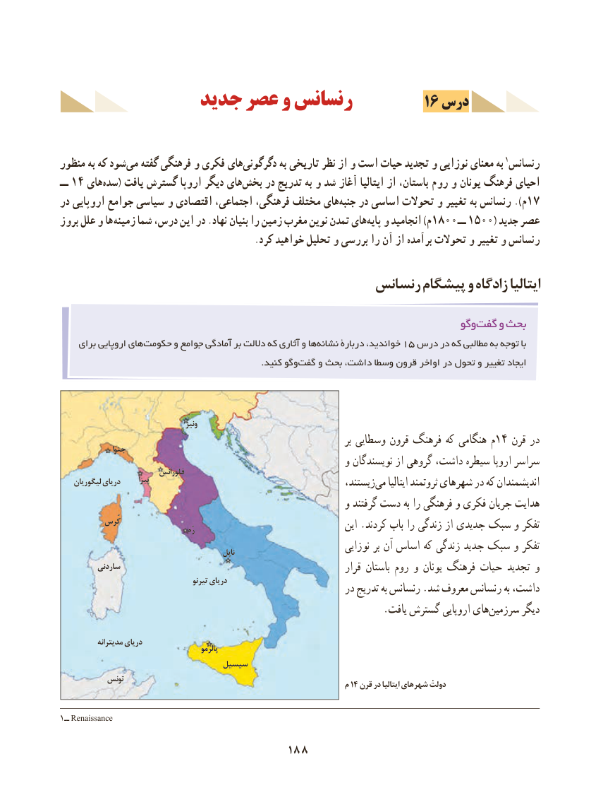

# PDF page 198

جدید عصر و رنسانس          16 درس

منظور به که شود‌می گفته فرهنگی و فکری های‌دگرگونی به تاریخی نظر از و است حیات تجدید و نوزایی معنای به 1 رنسانس
ــ 14 هایسده‌    ( یافت گسترش اروپا دیگر هایبخش‌    در تدریج به و شد آغاز ایتالیا از باستان، روم و یونان فرهنگ احیای
در اروپایی جوامع سیاسی و اقتصادی اجتماعی، فرهنگی، مختلف هایجنبه‌    در اساسی تحوالت و تغییر به رنسانس ).م17
بروز علل و ها زمینه شما درس، این در .نهاد بنیان را زمین مغرب نوین تمدن هایپایه‌  و انجامید )م1800 ــ 1500( جدید عصر
                                          .کرد خواهید تحلیل و بررسی را آن از برآمده تحوالت و تغییر و رنسانس

                                         رنسانس پیشگام و زادگاه ایتالیا

                                                                           وگوگفت‌    و بحث
    برای اروپایی های‌حکومت و جوامع آمادگی بر داللت که آثاری و ها‌نشانه دربارۀ خواندید، 15 درس در که مطالبی به توجه با
                                                                     .کنید وگو ‌گفت و بحث داشت، وسطا قرون اواخر در تحول و تغییر ایجاد

                                         ونيز
                                                                                       بر وسطایی قرون فرهنگ که هنگامی م14 قرن در               جنوا
                                                          و نویسندگان از گروهی داشت، سیطره اروپا سراسر                           فلورانس
    ليگوريان درياي      پيزا                                             زیستند،می‌    ایتالیا ثروتمند شهرهای در که اندیشمندان
                                                          و گرفتند دست به را فرهنگی و فکری جریان هدایت
           كُرس                                                 رُم                                     این .کردند باب را زندگی از جدیدی سبک و تفکر
                                                    ناپل                           نوزایی بر آن اساس که زندگی جدید سبک و تفکر
          ساردني                                                                      قرار باستان روم و یونان فرهنگ حیات تجدید و
                                          تيرنو درياي                        در تدریج به رنسانس .شد معروف رنسانس به داشت،
      .‌یافت گسترش اروپایی هایسرزمین دیگر

           مديترانه درياي                                                پالرمو
                                سيسيل
           تونس                                                               م 14 قرن در ایتالیا شهرهای دولتْ

1ــ Renaissance
                                  188

