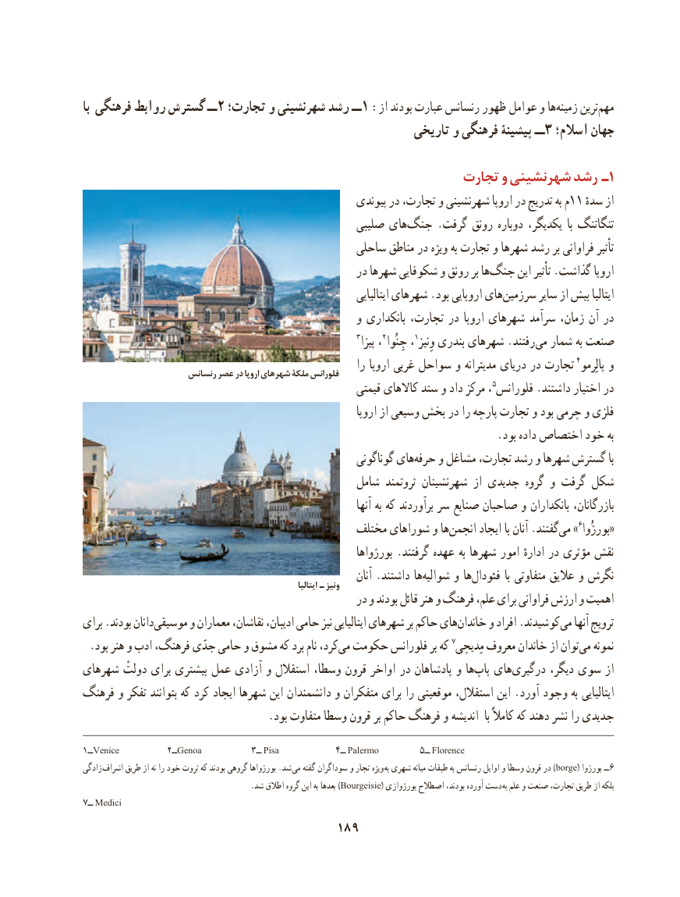

# PDF page 199

با فرهنگی روابط گسترش ــ 2 تجارت؛ و شهرنشینی رشد ــ1 :از بودند عبارت رنسانس ظهور عوامل و ها ‌زمینه ترین‌مهم
                                                        تاریخی و فرهنگی پیشینۀ ــ 3 اسالم؛ جهان

               تجارت۱و شهرنشینی رشد ـ
                                                       پیوندی در تجارت، و شهرنشینی اروپا در تدریج به م11 ٔازسده
                                                 صلیبی های ‌جنگ .گرفت رونق دوباره یکدیگر،  با تنگاتنگ
                                              ساحلی مناطق در ویژه به تجارت و شهرها رشد بر فراوانی تأثیر
                                                   در شهرها شکوفایی و رونق بر هاجنگ‌      این تأثیر .گذاشت اروپا
                                                                            ایتالیایی شهرهای .بود اروپایی هایسرزمین‌       سایر از بیش ایتالیا
                                                  و بانکداری تجارت، در اروپا شهرهای سرآمد زمان، آن در
                                                                    3پیزا ،2جِنُوا ،1وِنیز بندری شهرهای .رفتند ‌می شمار به صنعت
                                                              را اروپا غربی سواحل و مدیترانه دریای در تجارت 4پالِرمو و                      رنسانس عصر در اروپا شهرهای ملکۀ فلورانس
                                                        قیمتی کاالهای ستد و داد مرکز ، 5فلورانس .داشتند اختیار در
                                                                   اروپا از وسیعی بخش در را پارچه تجارت و بود چرمی و فلزی
                                                                            .بود داده اختصاص خود به
                                                          گوناگونی هایحرفه‌    و مشاغل تجارت، رشد و شهرها گسترش با
                                               شامل ثروتمند شهرنشینان از جدیدی گروه و گرفت شکل
                                                                           آنها به که برآوردند سر صنایع صاحبان و بانکداران بازرگانان،
                                             مختلف شوراهای و هاانجمن‌      ایجاد با آنان .گفتندمی‌»6«بورژُوا
                                                             بورژواها .گرفتند عهده به شهرها امور ادارهٔ در مؤثری نقش
                                                                       آنان .داشتند هاشوالیه‌     و هافئودال‌           با متفاوتی عالیق و نگرش                                                                             ایتالیا ـ ونيز
                                                    در و بودند قائل هنر و فرهنگ علم، برای فراوانی ارزش و اهمیت
برای .بودند دانانموسیقی‌      و معماران نقاشان، ادیبان، حامی نیز ایتالیایی شهرهای بر حاکم هایخاندان‌     و افراد .کوشیدندمی‌   آنها ترویج
.‌بود هنر و ادب فرهنگ، جدّی حامی و مشوق که برد نام کرد،می حکومت فلورانس بر که 7مِدیچی معروف خاندان از توانمی‌   نمونه
شهرهای دولتْ برای بیشتری عمل آزادی و استقالل وسطا، قرون اواخر در پادشاهان و ها‌پاپ های‌درگیری دیگر، سوی از
فرهنگ و تفکر بتوانند که کرد ایجاد شهرها این دانشمندان و متفکران برای را موقعیتی استقالل، این .آورد وجود به ایتالیایی
                                  .بود متفاوت وسطا قرون بر حاکم فرهنگ و اندیشه  با کامالً که دهند نشر را جدیدی

1ــVenice          2ــGenoa          3ــ Pisa           4ــ Palermo        5ــ Florence
زادگی  اشراف طریق از نه را خود ثروت که بودند گروهی بورژواها .شد می گفته سوداگران و تجار ویژه  )به شهری میانه طبقات به رنسانس اوایل و وسطا قرون در borge( بورژوا ــ6
    .)شد اطالق گروه این به بعدها Bourgeisie( بورژوازی اصطالح بودند، آورده دست  به علم و صنعت تجارت، طریق از بلکه
7ــ Medici
                                    189

