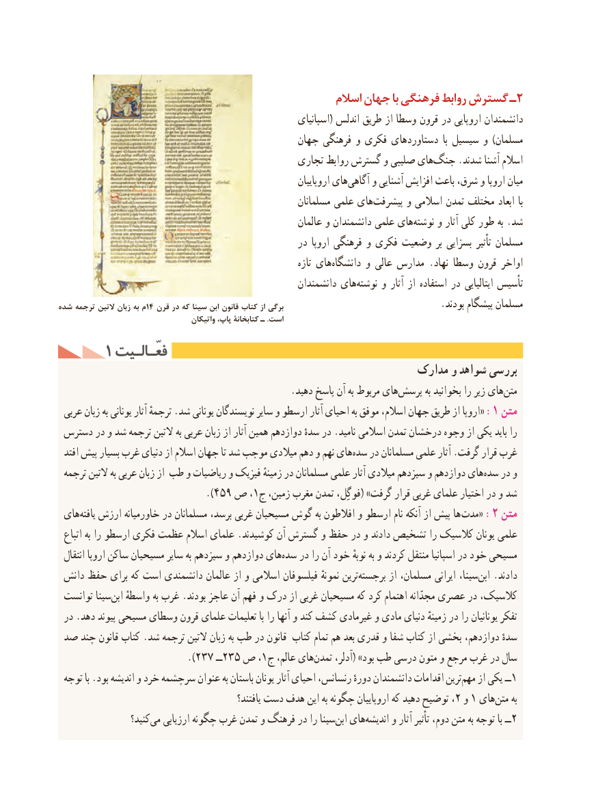

# PDF page 200

اسالم جهان با فرهنگی روابط گسترش ـ2
                                                             اسپانیای( اندلس طریق از وسطا قرون در اروپایی دانشمندان
                                              جهان فرهنگی و فکری دستاوردهای  با سیسیل و )مسلمان
                                               تجاری روابط گسترش و صلیبی های‌جنگ .شدند آشنا اسالم
                                                                    اروپاییان های‌آگاهی و آشنایی افزایش باعث شرق، و اروپا میان
                                                           مسلمانان علمی های‌پیشرفت و اسالمی تمدن مختلف ابعاد با
                                                            عالمان و دانشمندان علمی هاینوشته‌     و آثار کلی طور به .شد
                                                   در اروپا فرهنگی و فکری وضعیت بر بسزایی تأثیر مسلمان
                                                                        تازه های ‌دانشگاه و عالی مدارس .نهاد وسطا قرون اواخر
                                                        دانشمندان های ‌نوشته و آثار از استفاده در ایتالیایی تأسیس
شده ترجمه التين زبان به م14 قرن در كه سينا ابن قانون كتاب از برگي                                 .بودند پیشگام مسلمان
                                       واتیکان پاپ، کتابخانۀ ـ .است
     1 فعّـالـیتفعّـالـیت
                                                          مدارک و شواهد بررسی
    .‌دهید پاسخ آن به مربوط هایپرسش به بخوانید را زیر هایمتن‌
 عربی زبان به یونانی آثار ترجمهٔ .شد یونانی نویسندگان سایر و ارسطو آثار احیای به موفق اسالم، جهان طریق از اروپا« :1 متن
 دسترس در و شد ترجمه التین به عربی زبان از آثار همین دوازدهم سدهٔ در .نامید اسالمی تمدن درخشان وجوه از یکی باید را
  افتد پیش بسیار غرب دنیای از اسالم جهان تا شد موجب میالدی دهم و نهم هایسده‌   در مسلمانان علمی آثار .گرفت قرار غرب
 ترجمه التین به عربی زبان از طب و ریاضیات و فیزیک زمینهٔ در مسلمانان علمی آثار میالدی سیزدهم و دوازدهم های‌سده در و
                            ).459 ص ،1ج زمین، مغرب تمدن فوگِل،( »گرفت قرار غربی علمای اختیار در و شد
 های ‌یافته ارزش خاورمیانه در مسلمانان برسد، غربی مسیحیان گوش به افالطون و ارسطو نام آنکه از پیش ها  :مدت« 2 متن
  اتباع به را ارسطو فکری عظمت اسالم علمای .کوشیدند آن گسترش و حفظ در و دادند تشخیص را کالسیک یونان علمی
  انتقال اروپا ساکن مسیحیان سایر به سیزدهم و دوازدهم های‌سده در را آن خود نوبهٔ به و کردند منتقل اسپانیا در خود مسیحی
 دانش حفظ برای که است دانشمندی عالمان از و اسالمی فیلسوفان نمونهٔ ترینبرجسته‌       از مسلمان، ایرانی سینا،ابن‌   .دادند
 توانست سیناابن‌   واسطهٔ به غرب .بودند عاجز آن فهم و درک از غربی مسیحیان که کرد اهتمام مجدّانه عصری در کالسیک،
 در .دهد پیوند مسیحی وسطای قرون علمای تعلیمات با را آنها و کند کشف غیرمادی و مادی دنیای زمینه‌ٔتفکردر را یونانیان
 صد چند قانون کتاب .شد ترجمه التین زبان به طب در قانون کتاب تمام هم بعد قدری و شفا کتاب از بخشی دوازدهم، سدهٔ
                         ).237 ــ235 ص ،1ج عالم، هایتمدن‌     آدلر،( »بود طب درسی متون و مرجع غرب در سال
 توجه با .بود اندیشه و خرد سرچشمه عنوان به باستان یونان آثار احیای رنسانس، دورهٔ دانشمندان اقدامات ترینمهم‌    از یکی ــ1
                                                     یافتند؟ دست هدف این به چگونه اروپاییان که دهید توضیح ،2 و 1 هایمتن‌     به
                   کنید؟‌می ارزیابی چگونه غرب تمدن و فرهنگ در را سیناابن‌  های‌اندیشه و آثار تأثیر دوم، متن به توجه با ــ2                                          190

