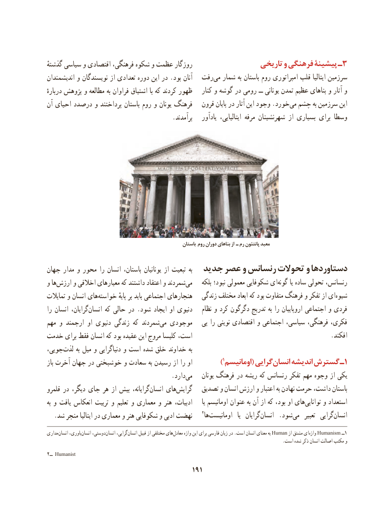

# PDF page 201

ٔروزگارگذشته سیاسی و اقتصادی فرهنگی، شکوه و عظمت                       تاریخی و فرهنگی پیشینۀ ـ3
اندیشمندان و نویسندگان از تعدادی دوره این در .بود آنان  رفت‌می شمار به باستان روم امپراتوری قلب ایتالیا سرزمین
دربارهٔ پژوهش و مطالعه به فراوان اشتیاق با که کردند ظهور    کنار و گوشه در رومی ــ یونانی تمدن عظیم بناهای و آثار و
آن احیای درصدد و پرداختند باستان روم و یونان فرهنگ   قرون پایان در آثار این وجود .خوردمی‌  چشم به سرزمین این
                                       .برآمدند    یادآور  ایتالیایی، مرفه شهرنشینان از بسیاری برای وسطا

                                                            باستان روم دوران بناهای از ـ رم پانتئون معبد

جهان مدار و محور را انسان باستان، یونانیان از تبعیت به  جدید عصر و رنسانس تحوالت و دستاوردها
و ها‌ارزش و اخالقی معیارهای که داشتند اعتقاد و شمردندمی‌      بلکه نبود؛ معمولی شکوفایی ایگونه‌      یا ساده تحولی رنسانس،
تمایالت و انسان هایخواسته‌             پایهٔ بر باید اجتماعی هنجارهای   زندگی مختلف ابعاد که بود متفاوت فرهنگ و تفکر از ای‌شیوه
را انسان گرایان،انسان‌     که حالی در .شود ایجاد او دنیوی      ‌نظام و کرد دگرگون تدریج به را اروپاییان اجتماعی و فردی
مهم و ارجمند او دنیوی زندگی که شمردندمی‌  موجودی   پی را نوینی اقتصادی و اجتماعی سیاسی، فرهنگی، فکری،
خدمت برای فقط انسان که بود عقیده این مروج کلیسا است،                                             .افکند
جویی، ‌لذت به میل و دنیاگرایی و است شده خلق خداوند به
باز آخرت جهان در خوشبختی و سعادت به رسیدن از را او           )1اومانیسم( گراییانسان‌     اندیشه گسترش ـ1
                .‌داردمی    یونان فرهنگ در ریشه که رنسانس تفکر مهم وجوه از یکی
قلمرو در دیگر، جای هر از بیش گرایانه،انسان‌    های‌گرایش   تصدیق و انسان ارزش و اعتبار به نهادن حرمت داشت، باستان
به و یافت انعکاس تربیت و تعلیم و معماری و هنر ادبیات،      یا اومانیسم عنوان به آن از که بود، او هایتوانایی‌     و استعداد
  .شد منجر ایتالیا در معماری و هنر شکوفایی و ادبی نهضت    2ها ‌اومانیست   یا  گرایانانسان‌     .شودمی‌     تعبیر  گرایی‌انسان
مداری ‌انسان باوری،‌انسان دوستی،‌انسان گرایی،‌انسان قبیل از مختلفی هایمعادل‌     واژه این برای فارسی زبان در .است انسان معنای به Human از مشتق ای ‌واژه Humanism ــ1
                                                                                                           .است شده ذکر انسان اصالت مکتب و
2ــ Humanist
                                           191

