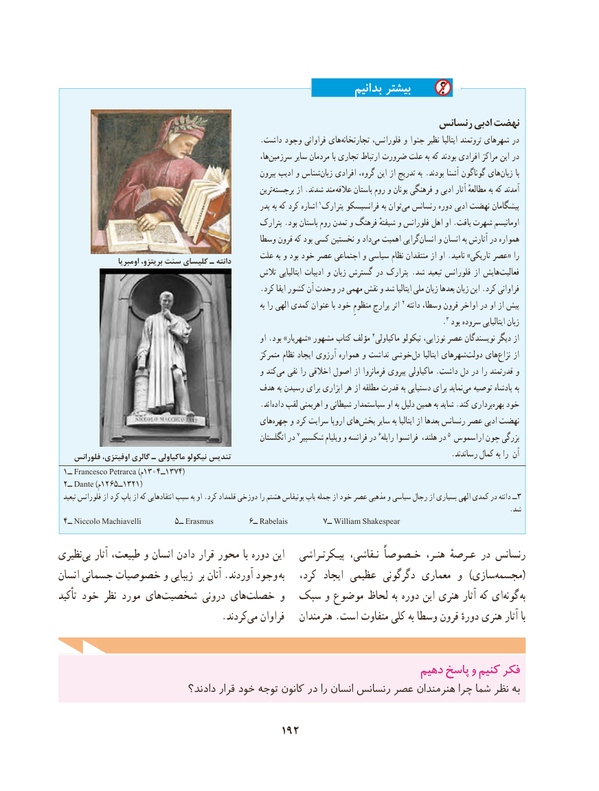

# PDF page 202

بدانیم بیشتر

                                                                    رنسانس ادبی نهضت
                                                     .داشت وجود فراوانی هایتجارتخانه‌        فلورانس، و جنوا نظیر ایتالیا ثروتمند شهرهای در
                                                                    ها،‌سرزمین سایر مردمان با تجاری ارتباط ضرورت علت به که بودند افرادی مراکز این در
                                                                بیرون ادیب و شناسزبان‌    افرادی گروه، این از تدریج به .بودند آشنا گوناگون های ‌زبان با
                                                                 ترین‌برجسته از .شدند مند عالقه باستان روم و یونان فرهنگی و ادبی آثار مطالعهٔ به که آمدند
                                                              پدر به که کرد اشاره 1پترارک فرانسیسکو به توانمی‌  رنسانس دوره ادبی نهضت پیشگامان
                                                       پترارک .بود باستان روم تمدن و فرهنگ شیفتهٔ و فلورانس اهل او .یافت شهرت اومانیسم
                                                  وسطا قرون که بود کسی نخستین و دادمی‌  اهمیت گرایی‌انسان و انسان به آثارش در همواره
                                             علت به و بود خود عصر اجتماعی و سیاسی نظام منتقدان از او .نامید »تاریکی عصر« را                    اومبریا بریتزو، سنت کلیسای ـ دانته
                                                  تالش ایتالیایی ادبیات و زبان گسترش در پترارک .شد تبعید فلورانس از هایشفعالیت‌
                                                     .کرد ایفا کشور آن وحدت در مهمی نقش و شد ایتالیا ملی زبان بعدها زبان این .کرد فراوانی
                                                                                      به را الهی کمدی عنوان با خود منظومِ پرارج اثر 2 دانته وسطا، قرون اواخر در او از پیش
                                                                                                      .3 بود سروده ایتالیایی زبان
                                                                   او .بود »شهریار« مشهور کتاب مؤلف 4ماکیاولی نیکولو نوزایی، عصر نویسندگان دیگر از
                                                             متمرکز ‌نظام ایجاد آرزوی همواره و نداشت خوشی ‌دل ایتالیا شهرهای‌دولت های ‌نزاع از
                                                      و کندمی‌   نفی را اخالقی اصول از فرمانروا پیروی ماکیاولی .داشت دل در را قدرتمند و
                                         هدف به رسیدن برای ابزاری هر از مطلقه قدرت به دستیابی برای نمایدمی‌  توصیه پادشاه به
                             .‌اندداده لقب اهریمنی و شیطانی سیاستمدار او به دلیل همین به شاید .کند برداری ‌بهره خود
                                                های‌چهره و کرد سرایت اروپا های‌بخش سایر به ایتالیا از بعدها رنسانس عصر ادبی نهضت
                                                              انگلستان در 7شکسپیر ویلیام و فرانسه در 6رابله فرانسوا هلند، در 5 اراسموس چون بزرگی
    فلورانس اوفیتزی، گالری ـ ماكياولي نيكولو تنديس                                                          .رساندند کمال به را آن
 ۱ــ Francesco Petrarca (م1304ــ13٧4)
 ۲ ــ Dante (م1265ــ1321)
تبعید۳فلورانس از کرد پاپ از که انتقادهایی سبب به او .کرد قلمداد دوزخی را هشتم بونیفاس پاپ جمله از خود عصر مذهبی و سیاسی رجال از بسیاری الهی کمدی در دانته ــ
                                                                                                                                   .شد
 ۴ــ Niccolo Machiavelli        ۵ــ Erasmus        ۶ــ Rabelais        ۷ــ William Shakespear
نظیری ‌بی آثار طبیعت، و انسان دادن قرار محور با دوره این    پیـکرتـراشی نـقاشی، خـصوصاً هنـر، عـرصهٔ در رنسانس
انسان جسمانی خصوصیات و زیبایی  بر آنان .آوردند وجود به   کرد،  ایجاد عظیمی   ‌دگرگونی معماری و  )سازیمجسمه‌(
تأکید خود نظر مورد های‌شخصیت درونی های ‌خصلت و  سبک و موضوع لحاظ به دوره این هنری آثار که ای ‌گونه به
            .‌کردندمی فراوان    هنرمندان .است متفاوت کلی به وسطا قرون دورهٔ هنری آثار با

                                                              دهیمدهیم پاسخپاسخ وو کنیمکنیم فکرفکر
                            دادند؟ قرار خود توجه کانون در را انسان رنسانس عصر هنرمندان چرا شما نظر به

                                      192

