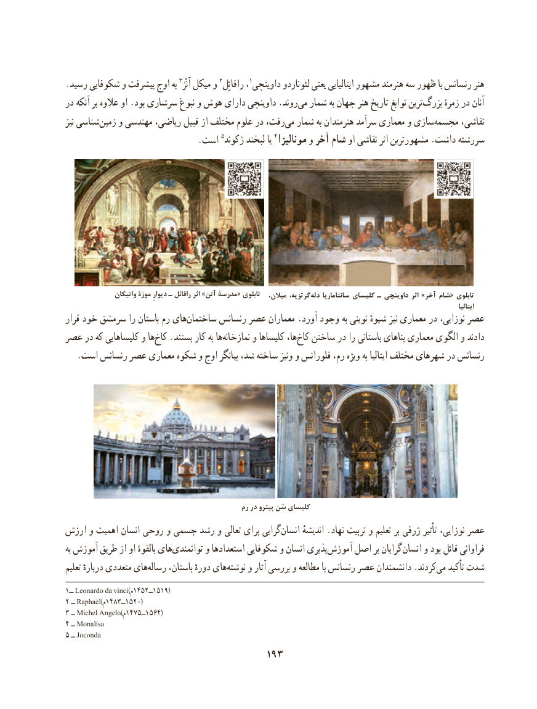

# PDF page 203

.رسید شکوفایی و پیشرفت اوج به 3آنْژ میکل و 2رافائِل ،1داوینچی لئوناردو یعنی ایتالیایی مشهور هنرمند سه ظهور با رنسانس هنر
در آنکه بر عالوه او .بود سرشاری نبوغ و هوش دارای داوینچی .روند ‌می شمار به جهان هنر تاریخ نوابغ ترین‌بزرگ زمرهٔ در آنان
نیز شناسیزمین‌    و مهندسی ریاضی، قبیل از مختلف علوم در رفت، ‌می شمار به هنرمندان سرآمد معماری و سازیمجسمه‌      نقاشی،
          .5است ژکوند لبخند یا 4مونالیزا و آخر شام او نقاشی اثر مشهورترین .داشت سررشته

                واتیکان موزۀ دیوارِ ـ رافائل اثر »آتن مدرسۀ« تابلوی  ،گرتزیه،میالن              دله سانتاماریا کلیسای ـ داوینچی اثر »آخر شام« تابلوی
                                                                                                                                                                              ایتالیا
قرار خود سرمشق را باستان رم هایساختمان‌       رنسانس عصر معماران .آورد وجود به نوینی شیوهٔ نیز معماری در نوزایی، عصر
عصر در که کلیساهایی و ها ‌کاخ .بستند کار به ها ‌نمازخانه و کلیساها ها،کاخ‌   ساختن در را باستانی بناهای معماری الگوی و دادند
   .است رنسانس عصر معماری شکوه و اوج بیانگر شد، ساخته ونیز و فلورانس رم، ویژه به ایتالیا مختلف شهرهای در رنسانس

                                                  رم در پيترو سَن كليساي
ارزش و اهمیت انسان روحی و جسمی رشد و تعالی برای گراییانسان‌      اندیشهٔ .نهاد تربیت و تعلیم بر ژرفی تأثیر نوزایی، عصر
به آموزش طریق از او بالقوهٔ های ‌توانمندی و استعدادها شکوفایی و انسان پذیریآموزش‌    اصل بر گرایان انسان و بود قائل فراوانی
تعلیم دربارهٔ متعددی های‌رساله باستان، دورهٔ های ‌نوشته و آثار بررسی و مطالعه با رنسانس عصر دانشمندان .کردندمی‌   تأکید شدت
1ــ Leonardo da vinci)م1452ــ1519(
2 ــ Raphael)م1483ــ1520(
3 ــ Michel Angelo)م1475ــ1564(
4 ــ Monalisa
5 ــ Joconda
                                     193

