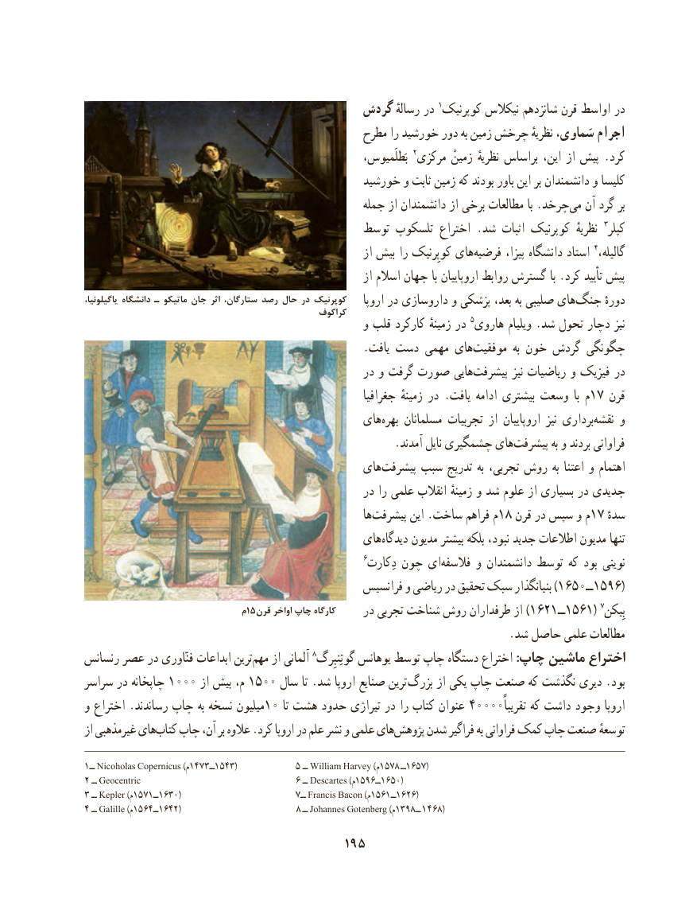

# PDF page 205

گردش رسالهٔ در 1کوپرنیک نیکالس شانزدهم قرن اواسط در
                                               مطرح را خورشید دور به زمین چرخش نظریهٔ سَماوی، اجرام
                                                              بَطلَمیوس، 2مرکزی زمینْ نظریهٔ براساس این، از پیش .کرد
                                             خورشید و ثابت زمین که بودند باور این بر دانشمندان و کلیسا
                                                   جمله از دانشمندان از برخی مطالعات با .چرخد‌می آن گرد بر
                                          توسط تلسکوپ اختراع .شد اثبات کوپرنیک  نظریهٔ  3کپلر
                                                              از بیش را کوپِرنیک های‌فرضیه پیزا، دانشگاه استاد 4،گالیله
                                                              از اسالم جهان با اروپاییان روابط گسترش با .کرد تأیید پیش
یاگیلونیا، دانشگاه ـ ماتیکو جان اثر ستارگان، رصد حال در کوپرنیک                                                                   اروپا در داروسازی و پزشکی بعد، به صلیبی های‌جنگ دورهٔ                                                  کراکوف
                                                  و قلب کارکرد زمینهٔ در 5هاروی ویلیام .شد تحول دچار نیز
                                                  .یافت دست مهمی های ‌موفقیت  به خون گردش چگونگی
                                                   در و گرفت صورت هایی‌پیشرفت نیز ریاضیات و فیزیک در
                                                            جغرافیا زمینهٔ در .یافت ادامه بیشتری وسعت  با م17 قرن
                                              های‌بهره مسلمانان تجربیات از اروپاییان  نیز برداری‌نقشه و
     .‌آمدند نایل چشمگیری هایپیشرفت به و بردند فراوانی
                                              های‌پیشرفت سبب تدریج به تجربی، روش به اعتنا و اهتمام
                                                   در را علمی انقالب زمینهٔ و شد علوم از بسیاری در جدیدی
                                                               ها‌پیشرفت این .ساخت فراهم م18 قرن در سپس و م17 ٔسده
                                              های‌دیدگاه مدیون بیشتر بلکه نبود، جدید اطالعات مدیون تنها
                                                                    6دِکارت چون ای‌فالسفه و دانشمندان توسط که بود نوینی
                                                 فرانسیس و ریاضی در تحقیق سبک بنیانگذار )1650ــ1596(
                               م15قرن اواخر چاپ كارگاه                                                   در تجربی شناخت روش طرفداران از )1621ــ1561( 7بِیکن
                                                                            .شد حاصل علمی مطالعات
رنسانس عصر در فنّاوری ابداعات ترینمهم‌    از آلمانی 8گوتِنبِرگ یوهانس توسط چاپ دستگاه اختراع :چاپ ماشین اختراع
سراسر در چاپخانه 1000 از بیش م، 1500 سال تا .شد اروپا صنایع ترین بزرگ از یکی چاپ صنعت که نگذشت دیری .بود
و اختراع .رساندند چاپ به نسخه میلیون10 تا هشت حدود تیراژی در را کتاب عنوان 40000تقریباًاروپاکه داشت وجود
از غیرمذهبی هایکتاب‌   چاپ آن، بر عالوه .کرد اروپا در علم نشر و علمی هایپژوهش‌    شدن فراگیر به فراوانی کمک چاپ صنعت توسعهٔ

1ــ Nicoholas Copernicus (م1473ــ1543)            5 ــ William Harvey (م1578 ــ1657)
2 ــ Geocentric                               6 ــ Descartes (م1596ــ1650)
3 ــ Kepler (م1571ــ1630)                       7ــ Francis Bacon (م1561ــ1626)
4 ــ Galille (م1564ــ1642)                                              8 ــ Johannes Gotenberg (م1398ــ 1 468)
                                     195

