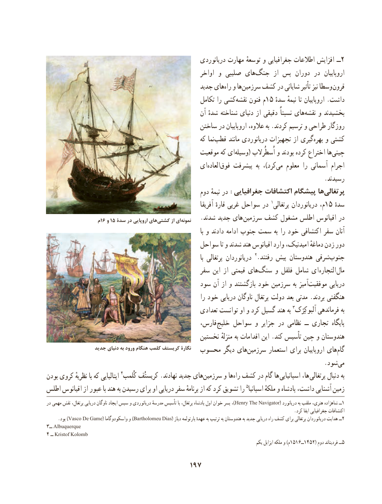

# PDF page 207

دریانوردی مهارت توسعهٔ و جغرافیایی اطالعات افزایش ــ2
                                                       اواخر و صلیبی های‌جنگ  از پس دوران در  اروپاییان
                                                 جدید های ‌راه و ها‌سرزمین کشف در شایانی تأثیر نیز وسطا قرون
                                                      تکامل را کشی‌نقشه فنون م15 ٔداشتسده نیمهٔ تا اروپاییان .
                                                       آن شدهٔ شناخته دنیای از دقیقی نسبتاً های‌نقشه و بخشیدند
                                              ساختن در اروپاییان عالوه، به .کردند ترسیم و طراحی روزگار
                                                         که نما‌قطب مانند دریانوردی تجهیزات از گیری‌بهره و کشتی
                                                  موقعیت که ای ‌وسیله( اُسطُرالب و بودند کرده اختراع ها ‌چینی
                                           ای‌العاده‌فوق پیشرفت  به ،)کردمی‌   معلوم را آسمانی اجرام
                                                                                           .رسیدند
                                                     دوم نیمهٔ در :جغرافیایی اکتشافات پیشگام هاپرتغالی‌
                                                                                         1                                                                       آفریقا قارهٔ غربی سواحل در  پرتغالی دریانوردان م،15 ٔسده
                  م16 و 15 سدة در اروپایی هایكشتی‌        از ای‌نمونه   .شدند جدید های سرزمین کشف مشغول اطلس اقیانوس در
                                                                                                 با و دادند ادامه جنوب سمت به را خود اکتشافی سفر آنان
                                          سواحل تا و شدند هند اقیانوس وارد امیدنیک، دماغهٔ زدن دور
                                                                                                 با پرتغالی دریانوردان 2.رفتند پیش هندوستان شرقیجنوب‌
                                                سفر این از قیمتی های ‌سنگ و فلفل شامل ای التجاره مال
                                            سود آن از و بازگشتند خود سرزمین به آمیزموفقیت‌        دریایی
                                                              را خود دریایی ناوگان پرتغال دولت بعد مدتی .بردند هنگفتی
                                                     تعدادی توانست او و کرد گسیل هند به 3آلبوکِرْک فرماندهی به
                                               فارس، خلیج سواحل و جزایر در نظامی  ــ تجاری  پایگاه
                                                 نخستین منزلهٔ به اقدامات این .کند تأسیس چین و هندوستان
                 جديد دنياي به ورود هنگام كلمب كريستف نگارۀ  محسوب دیگر های ‌سرزمین استعمار برای اروپاییان های ‌گام
                                    .‌شودمی
بودن کروی نظریهٔ با که ایتالیایی 4کُلمب کریستُف .نهادند جدید های‌سرزمین و ها‌راه کشف در گام ها  اسپانیایی ها،  پرتغالی دنبال به
اطلس اقیانوس از عبور با هند به رسیدن برای او دریایی سفر برنامهٔ از که کرد تشویق را 5اسپانیا ملکهٔ و پادشاه داشت، آشنایی زمین
در مهمی نقش پرتغال، دریایی ناوگان ایجاد سپس و دریانوردی مدرسهٔ تأسیس با پرتغال، پادشاه اول خوان پسر ،)Henry The Navigator( دریانورد به ملقب هنری، شاهزاده ــ1
                                                                                                                 .کرد ایفا جغرافیایی اکتشافات
   .Vascoبود )     De Game( واسکودوگاما و )Bartholomeu Dias( دیاز بارتولمه عهدهٔ به ترتیب به هندوستان به جدید دریایی راه کشف برای پرتغالی دریانوردان هدایت ــ2
3ــ Albuquerque
4 ــ Kristof Kolomb
                                                                                                       یکم ایزابل ملکه و )م1516ــ1452( دوم فردیناند ــ5

                                     197

