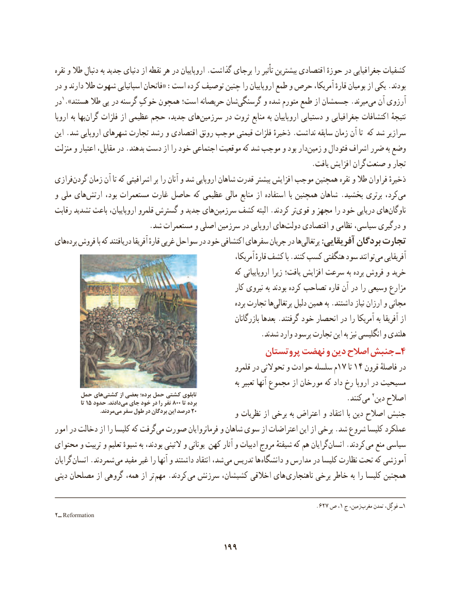

# PDF page 209

نقره و طال دنبال به جدید دنیای از نقطه هر در اروپاییان .گذاشت برجای را تأثیر بیشترین اقتصادی حوزهٔ در جغرافیایی کشفیات
در و دارند طال شهوت اسپانیایی فاتحان« :است کرده توصیف چنین را اروپاییان طمع و حرص آمریکا، قارهٔ بومیان از یکی .بودند
در1.»هستند طال پی در گرسنه خوکِ همچون است؛ حریصانه شانگرسنگی‌       و شده متورم طمع از جسمشان .میرندمی‌  آن آرزوی
اروپا به بها‌گران فلزات از عظیمی حجم جدید، های‌سرزمین در ثروت منابع به اروپاییان دستیابی و جغرافیایی اکتشافات نتیجهٔ
این .شد اروپایی شهرهای تجارت رشد و اقتصادی رونق موجب قیمتی فلزات ذخیرهٔ .نداشت سابقه زمان آن تا که شد سرازیر
منزلت و اعتبار مقابل، در .بدهند دست از را خود اجتماعی موقعیت که شد موجب و بود دار‌زمین و فئودال اشراف ضرر به وضع
                                                                       .یافت افزایش گران صنعت و تجار
فرازی‌گردن زمان آن تا که اشرافیتی بر را آنان و شد اروپایی شاهان قدرت بیشتر افزایش موجب همچنین نقره و طال فراوان ذخیرهٔ
و ملی های ‌ارتش بود، مستعمرات غارت حاصل که عظیمی مالی منابع از استفاده  با همچنین شاهان .بخشید برتری کرد،می‌
رقابت تشدید باعث اروپاییان، قلمرو گسترش و جدید های‌سرزمین کشف البته .کردند ترقوی‌    و مجهز را خود دریایی های‌ناوگان
 .‌شد مستعمرات و اصلی سرزمین در اروپایی هایدولت اقتصادی و نظامی سیاسی، درگیری‌      و
هایبرده‌  فروش با که دریافتند آفریقا قارهٔ غربی سواحل در خود اکتشافی سفرهای جریان در هاپرتغالی‌        :آفریقایی بردگان تجارت
                                                                 آمریکا، قارهٔ کشف با .کنند کسب هنگفتی سود توانند می آفریقایی
                                                        که اروپاییانی زیرا یافت؛ افزایش سرعت به برده فروش و خرید
                                                           کار نیروی به بودند کرده تصاحب قاره آن در را وسیعی مزارع
                                                                     برده تجارت هاپرتغالی‌      دلیل همین به .داشتند نیاز ارزان و مجانی
                                                                   بازرگانان بعدها .گرفتند خود انحصار در را آمریکا به آفریقا از
                                                         .شدند وارد پرسود تجارت این به نیز انگلیسی و هلندی
                                                پروتستان نهضت و دین اصالح جنبش ـ4
                                                          قلمرو در تحوالتی و حوادث سلسله م17 تا 14 قرون فاصلهٔ در
                                                                                به تعبیر آنها مجموع از مورخان که داد رخ اروپا در مسیحیت
       حمل            هایکشتی‌                                  از                     بعضی                                      برده؛                          حمل                              کشتی                                                    تابلوی
             تا 15 حدود                                     .دادند                  می‌                      جای                          خود در                                                       را نفر                                         800 تا                                                      برده                                          .کنندمی‌   2دین اصالح
      .‌مردندمی سفر طول در بردگان این درصد 20           و نظریات از برخی به اعتراض و انتقاد با دین اصالح جنبش
امور در دخالت از را کلیسا که گرفت ‌می صورت فرمانروایان و شاهان سوی از اعتراضات این از برخی .شد شروع کلیسا عملکرد
محتوای و تربیت و تعلیم شیوهٔ به بودند، التینی و یونانی کهن آثار و ادبیات مروج شیفتهٔ که هم گرایانانسان‌    .کردند  می منع سیاسی
گرایان انسان .شمردند می مفید غیر را آنها و داشتند انتقاد شد، می تدریس ها دانشگاه و مدارس در کلیسا نظارت تحت که آموزشی
دینی مصلحان از گروهی همه، از تر مهم .کردند می سرزنش کشیشان، اخالقی های  ناهنجاری برخی خاطر به را کلیسا همچنین

                                                                                     .627 ص ،1 ج زمین،مغرب‌    تمدن فوگِل، ــ1
2ــ Reformation

                                       199

