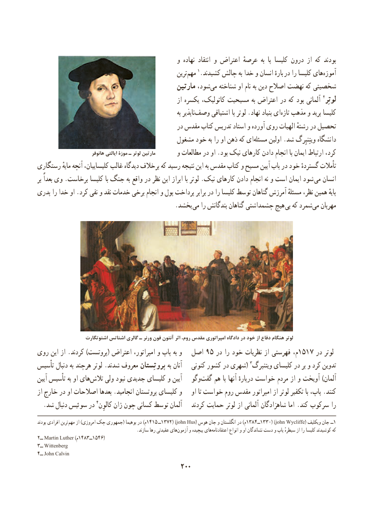

# PDF page 210

و نهاده  انتقاد و اعتراض عرصهٔ  به  پا کلیسا درون از که بودند
                                                       ترین‌مهم١.کشیدند‌چالش به خدا و انسان بارهٔ  در را کلیسا های‌آموزه
                                              مارتین شود،‌می شناخته او نام به دین اصالح نهضت که شخصیتی
                                                        از یکسره کاتولیک، مسیحیت به اعتراض در که بود آلمانی ٢لوتِر
                                                                         به ناپذیروصف‌      اشتیاقی با لوتر .نهاد بنیاد ای ‌تازه مذهب و برید کلیسا
                                              در مقدس کتاب تدریس استاد و آورده روی الهیات رشتهٔ در تحصیل
                                         مشغول خود به را او ذهن که ای‌مسئله اولین .شد ویتِنبِرگ دانشگاه
                          هانوفر ایالتی موزة ـ لوتر مارتین       و مطالعات در او .بود نیک کارهای دادن انجام با ایمان ارتباط کرد،
رستگاری مایهٔ آنچه کلیساییان، غالب دیدگاه برخالف که رسید نتیجه این به مقدس کتاب و مسیح آیین باب در خود گستردهٔ تأمالت
بر بعداً وی .برخاست کلیسا با جنگ به واقع در نظر این ابراز با لوتر .نیک کارهای دادن انجام نه و است ایمان شود می انسان
پدری را خدا او .کرد نفی و نقد خدمات برخی انجام و پول پرداخت برابر در را کلیسا توسط گناهان آمرزش مسئلهٔ نظر، همین پایهٔ
                                             .بخشد می را بندگانش گناهان چشمداشتی هیچ  بی که شمردمی‌   مهربان

                   اشتوتگارت اشتاتس گالری ـ ورنر فون آنتون اثر روم، مقدس امپراتوری دادگاه در خود از دفاع هنگام لوتر
روی این از .کردند )پروتست( اعتراض امپراتور، و پاپ به و  اصل 95 در را خود نظریات از فهرستی م،1517 در لوتر
تأسیس دنبال به هرچند لوتر .شدند معروف پروتِستان به آنان   کنونی کشور در شهری( ٣تدوینویتنبرگ کلیسای در بر و کرد
آیین تأسیس به او های ‌تالش ولی نبود جدیدی کلیسای و آیین   وگو‌گفت هم با آنها دربارهٔ خواست مردم از و آویخت )آلمان
از خارج در او اصالحات بعدها .انجامید پروتستان کلیسای و    او تا خواست روم مقدس امپراتور از لوتر تکفیر با پاپ، .کنند
  .شد دنبال سوئیس در ٤آلمانکالوِن ژان چون کسانی توسط         کردند حمایت لوتر از آلمانی شاهزادگان اما .کند سرکوب را
بودند افرادی ترین  مهم از )امروزی چک جمهوری( بوهیما در )م1415 ــ1372( )john Hus( هوس جان و انگلستان در )م1384ــ1330( )john Wycliffe( ویکلیف جان ــ1
                                             .سازند رها عقیدتی هایآزمون‌     و پیچیده هایاعتقادنامه‌         انواع و او نشاندگان دست و پاپ سیطرهٔ از را کلیسا کوشیدند که
٢ــ Martin Luther )م1483ــ1546(
٣ــ Wittenberg
4ــ John Calvin
                                          200

