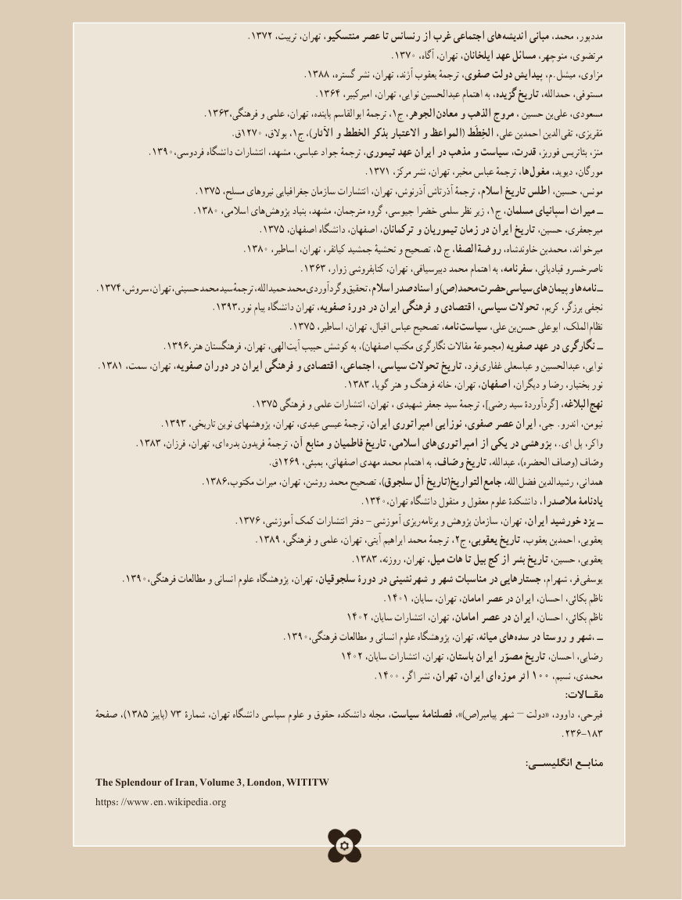

# PDF page 215

.1372 ،هایتربیت تهران، منتسکیو، عصر تا رنسانس از غرب اجتماعی        اندیشه مبانی محمد، مددپور،
                                                         .1370 ،مرتضوی،آگاه تهران، ایلخانان، عهد مسائل منوچهر،
                                            .1388  ،مزاوی،گستره نشر تهران، آژند، یعقوب ترجمهٔ صفوی، دولت پیدایش م،.میشل
                                          .1364 ،مستوفی،امیرکبیر تهران، نوایی، عبدالحسین اهتمام به گزیده، تاریخ حمدالله،
                         .1363،،فرهنگی و علمی تهران، پاینده، ابوالقاسم ترجمهٔ 1ج الجوهر، معادن و الذهب مروج ، حسین بن علی مسعودی،
                     .1270ق  ،،بوالق 1ج ،)اآلثار و الخطط بذکر االعتبار و المواعظ( الخِطَط علی، احمدبن الدین تقی مَقریزی،
          .1390،منز،فردوسی دانشگاه انتشارات مشهد، عباسی، جواد ترجمهٔ تیموری، عهد ایران در مذهب و سیاست قدرت، فوربز، بئاتریس
                                                    .1371 ،ها،مرکز نشر تهران، مخبر، عباس ترجمهٔ       مغول دیوید، مورگان،
                   .1375 ،مونس،مسلح نیروهای جغرافیایی سازمان انتشارات تهران، آذرنوش، آذرتاش ترجمهٔ اسالم، تاریخ اطلس حسین،
                   .1380 ،هایاسالمی        پژوهش بنیاد مشهد، مترجمان، گروه جیوسی، خضرا سلمی نظر زیر ،1ج مسلمان، اسپانیای میراث ــ
                               .1375 ،میرجعفری،اصفهان دانشگاه اصفهان، ترکمانان، و تیموریان زمان در ایران تاریخ حسین،
                            .1380 ،،اساطیر تهران، کیانفر، جمشید تحشیهٔ و تصحیح 5 ج الصفا، روضة خاوندشاه، محمدبن میرخواند،
                                       .1363 ،ناصرخسروزوار کتابفروشی تهران، دبیرسیاقی، محمد اهتمام به سفرنامه، قبادیانی،
.1374 ،هایسروش تهران، حسینی، محمد سید ترجمهٔ حمیدالله، محمد گردآوردی و تحقیق اسالم، صدر اسناد و )ص( محمد حضرت سیاسی       پیمان و ها  نامه ــ
                      .1393،نجفینور پیام دانشگاه تهران صفویه، دورۀ در ایران فرهنگی و اقتصادی سیاسی، تحوالت کریم، برزگر،
                                     .1375 ،نامه،اساطیر تهران، اقبال، عباس تصحیح          سیاست علی، بن حسن ابوعلی الملک، نظام
             .1396،الهی،هنر فرهنگستان تهران،          آیت حبیب کوشش به ،)اصفهان مکتب نگارگری مقاالت مجموعهٔ( صفویه عهد در نگارگری ــ
.1381 ،فرد،سمت تهران، صفویه، دوران در ایران فرهنگی و اقتصادی اجتماعی، سیاسی، تحوالت تاریخ        غفاری عباسعلی و عبدالحسین نوایی،
                                                .1383 ،نورگویا هنر و فرهنگ خانه تهران، اصفهان، دیگران، و رضا بختیار،
                              .1375 فرهنگی و علمی انتشارات تهران، ، شهیدی جعفر سید ترجمهٔ ،]رضی سید گردآوردهٔ[ البالغه، نهج
            .1393 ،نیومن،تاریخی نوین پژوهشهای تهران، عبدی، عیسی ترجمهٔ ایران، امپراتوری نوزایی صفوی، عصر ایران جی، .اندرو
        .1383 ،ای،فرزان تهران،        بدره فریدون ترجمهٔ آن، منابع و فاطمیان تاریخ اسالمی، های  امپراتوری از یکی در پژوهشی ،.ای پل واکر،
                                        .ق1269 ،وصّافبمبئی اصفهانی، مهدی محمد اهتمام به وصّاف، تاریخ عبدالله، ،)الحضره وصاف(
                    .1386،التواریخمکتوب میراث تهران، روشن، محمد تصحیح ،)سلجوق آل تاریخ(               جامع الله،  فضل رشیدالدین همدانی،
                                                   .1340،یادنامۀتهران دانشگاه منقول و معقول علوم دانشکدهٔ مالصدرا،
                           .1376 ،آموزشی کمک انتشارات دفتر - آموزشی ریزی  برنامه و پژوهش سازمان تهران، ایران، خورشید یزد ــ
                               .1389 ،،فرهنگی و علمی تهران، آیتی، ابراهیم محمد ترجمهٔ 2ج یعقوبی، تاریخ بعقوب، احمدبن یعقوبی،
                                                 .1383 ،یعقوبی،روزنه تهران، میل، هات تا بیل کج از بشر تاریخ حسین،
     .1390،فرهنگی مطالعات و انسانی علوم  پژوهشگاه تهران، سلجوقیان، دورۀ در نشینی شهر و شهر مناسبات در جستارهایی شهرام، فر، یوسفی
                                                       .1401 ،ناظمسایان تهران، امامان، عصر در ایران احسان، بکائی،
                                              1402 ،ناظمسایان انتشارات تهران، امامان، عصر در ایران احسان، بکائی،
                                    .1390،هایفرهنگی مطالعات و انسانی علوم پژوهشگاه تهران، میانه،        سده در روستا و ،شهر ــ
                                             1402 ،رضایی،سایان انتشارات تهران، باستان، ایران مصوّر تاریخ احسان،
                                                     .1400 ،ایاگر نشر تهران، ایران،       موزه اثر 100 ،محمدی،نسیم
                                                                                                                                                                                      :مقـاالت
صفحهٔ ،)1385 پاییز( 73  ٔفیرحی،شماره تهران، دانشگاه سیاسی علوم و حقوق دانشکده مجله سیاست، فصلنامۀ ،)»ص(پیامبر شهر – دولت« داوود،
                                                                                        .236-183
                                                                                                                                                                      :انگلیسـی منابـع
The Splendour of Iran, Volume 3, London, WITITW
https://www.en.wikipedia.org
                                   205

