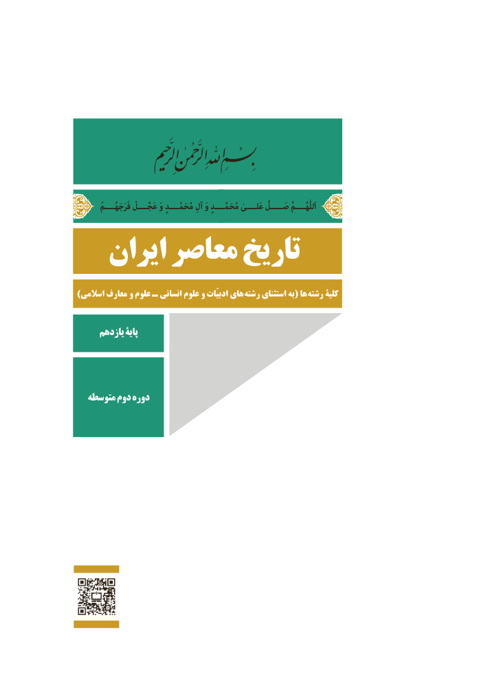

# PDF page 1

فَرَجَهُــــمْاَللّٰهُــــمَّعَجِّــــلْ وَ مُحَمَّــــدٍ آلِ وَ مُحَمَّــــدٍ عَلــــیٰ صَـــــلِّ
   ایران معاصر تاریخ
)اسالمی معارف و علوم ـ انسانی علوم و ادبیّات های رشته استثنای به( ها رشته کلیۀ

      یازدهم پایۀ

  متوسطه دوم دوره

