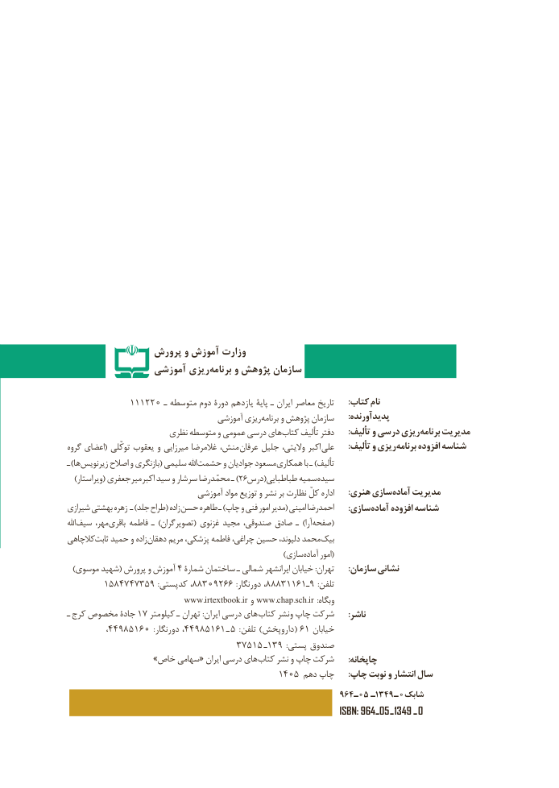

# PDF page 2

پرورش و آموزش وزارت
                آموزشي ريزي‌برنامه و پژوهش سازمان

            111220 ـ متوسطه دوم دورۀ یازدهم پایۀ ـ ایران معاصر تاریخ      :کتاب نام
                                    آموزشی ریزی برنامه و پژوهش سازمان      :پدیدآورنده
                      نظری متوسطه و عمومی درسی های کتاب تألیف دفتر : تألیف و درسی ریزی برنامه مدیریت
گروه اعضای( توکّلى یعقوب و میرزایى غالمرضا منش، عرفان جلیل والیتى، اکبر على : تألیف و ریزی برنامه افزوده شناسه
ـ )ها زیرنویس اصالح و بازنگری( سلیمی اهلل حشمت و جوادیان مسعود همکارى با ـ )تألیف
) ویراستار( جعفری میر )اکبر سید و سرشار محمّدرضا ـ 26درس(طباطبایی سمیه سیده
                               آموزشی مواد توزیع و نشر بر نظارت کلّ اداره      :هنری سازیآماده‌    مدیریت
شیرازی بهشتی زهره ـ )جلد طراح( زاده  حسن طاهره ـ )چاپ و فنی امور مدیر( امینی احمدرضا : سازی آماده افزوده شناسه
اهلل سیف مهر، باقری فاطمه ـ )تصویرگران( غزنوی مجید صندوقی، صادق ـ )آرا (صفحه
کالچاهیثابت​   حمید و زاده دهقان مریم پزشکی، فاطمه چراغی، حسین دلیوند، محمد بیک
             ) (سازی آماده امور
  )موسوی شهید( پرورش و آموزش ٤ شمارۀ ساختمان ـ شمالی ایرانشهر خیابان :تهران      :سازمان نشانی
  ١٣٨٨،٩٥٣٧٤٧٤٨٥٠٩٢٦٦:کدپستی                           :دورنگار١١٦١تلفن٣٨٨٨،     ٩ـ :
                               www.irtextbook.ir و www.chap.sch.ir :وبگاه
ـ  کرج١هایمخصوص جادۀ ٧ کیلومتر ـ تهران :ایران درسی       کتاب ونشر چاپ شرکت      :ناشر
                 ، 58944 160  : دورنگار١٦١٥٨٩٤٤،       ـ  (٥  : تلفن ) داروپخش ٦١ خیابان
                                 ٥٧٣١٥  ـ١صندوق٩٣  : پستی
  » خاص سهامی« ایران درسی های کتاب نشر و چاپ شرکت      :چاپخانه
            :140٥ دهم چاپ   چاپ نوبت و انتشار سال
                                                         964ـ05 ـ1349 ـ 0شابك
                                                                       ISBN: 964 ـ 05 ـ  1349 ـ 0

