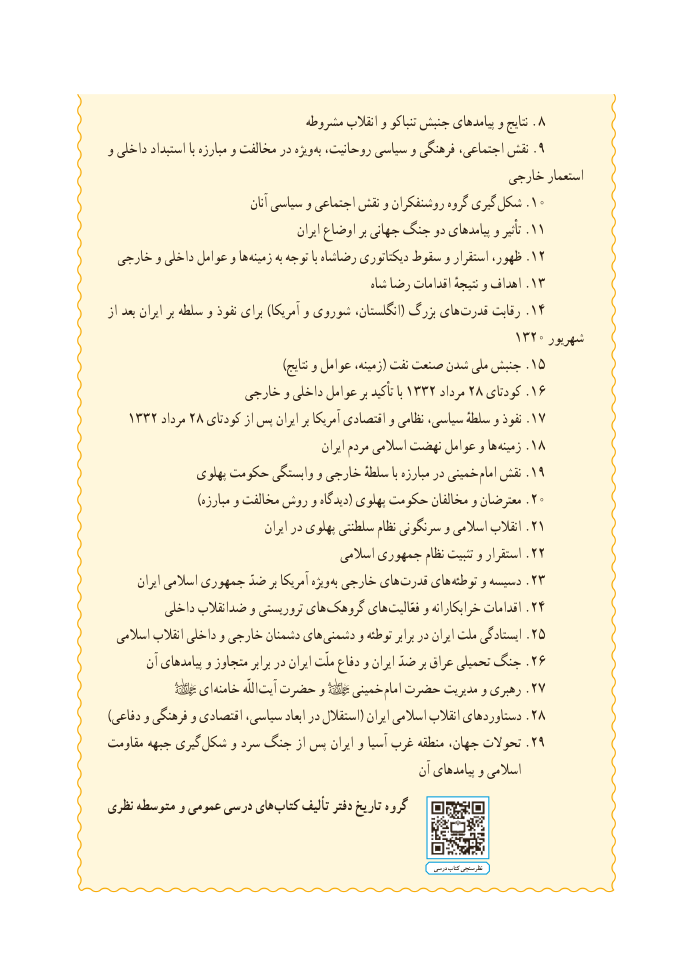

# PDF page 7

مشروطه انقالب و تنباکو جنبش پیامدهای و نتایج . ٨
و داخلی استبداد با مبارزه و مخالفت در ویژه به روحانیت، سیاسی و فرهنگی اجتماعی، نقش .٩
                                                        خارجی استعمار
                                  آنان سیاسی و اجتماعی نقش و روشنفکران گروه گیری  شکل .٠١
                                          ایران اوضاع بر جهانی جنگ دو پیامدهای و تأثیر .١١
 خارجی و داخلی عوامل و ها  زمینه به توجه با رضاشاه دیکتاتوری سقوط و استقرار ظهور، .٢١
                                                 شاه رضا اقدامات نتیجهٔ و اهداف .٣١
از بعد ایران بر سلطه و نفوذ برای )آمریکا و شوروی انگلستان،( بزرگ های قدرت رقابت .٤١
                                                      ٠٢٣١ شهریور
                                           )نتایج و عوامل زمینه،( نفت صنعت شدن ملی جنبش .٥١
                   خارجی و داخلی عوامل بر تأکید با ٢٣٣١ مرداد ٨٢ کودتای .٦١
   ٢٣٣١ مرداد ٨٢ کودتای از پس ایران بر آمریکا اقتصادی و نظامی سیاسی، سلطهٔ و نفوذ .٧١
                                               ایران مردم اسالمی نهضت عوامل و ها زمینه .٨١
               پهلوی حکومت وابستگی و خارجی سلطهٔ با مبارزه در خمینی امام نقش .٩١
                      )مبارزه و مخالفت روش و دیدگاه( پهلوی حکومت مخالفان و معترضان .٠٢
                                  ایران در پهلوی سلطنتی نظام سرنگونی و اسالمی انقالب .١٢
                                         اسالمی جمهوری نظام تثبیت و استقرار .٢٢
       ایران اسالمی جمهوری ضدّ بر آمریکا ویژه به خارجی های  قدرت های توطئه و دسیسه .٣٢
         داخلی ضدانقالب و تروریستی های  گروهک های  فعّالیت و خرابکارانه اقدامات .٤٢
  اسالمی انقالب داخلی و خارجی دشمنان های دشمنی و توطئه برابر در ایران ملت ایستادگی .٥٢
       آن پیامدهای و متجاوز برابر در ایران ملّت دفاع و ایران ضدّ بر عراق تحمیلی جنگ .٦٢
             ای خامنه اللّه آیت حضرت و    خمینی امام حضرت مدیریت و رهبری .٧٢
)دفاعی و فرهنگی و اقتصادی سیاسی، ابعاد در استقالل( ایران اسالمی انقالب دستاوردهای .٨٢
مقاومت جبهه گیری شکل و سرد جنگ از پس ایران و آسیا غرب منطقه جهان، تحوالت .29
                                                         آن پیامدهای و اسالمی
نظری متوسطه و عمومی درسی های کتاب تألیف دفتر تاریخ گروه

                                                                                             درسی کتاب نظرسنجی

