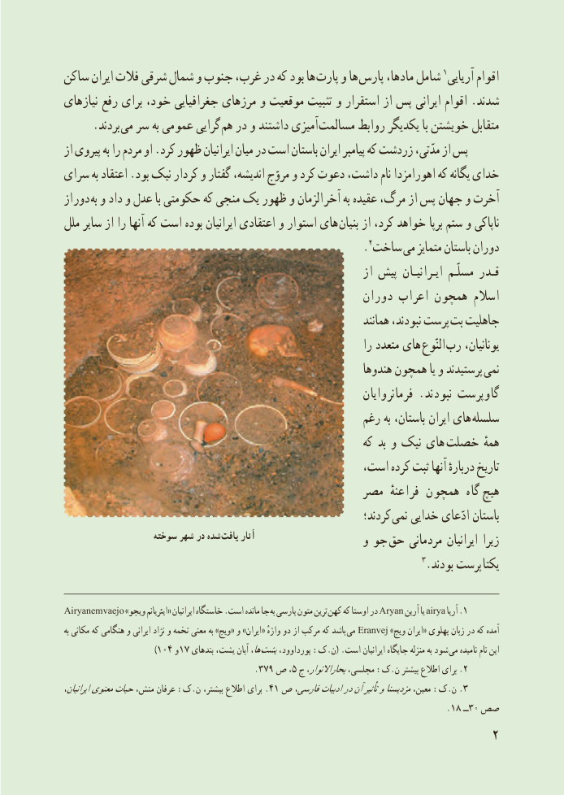

# PDF page 10

ساکن ایران فالت شرقی شمال و جنوب غرب، در که بود ها پارت و ها پارس مادها، شامل 1آریایی اقوام
نیازهای رفع برای خود، جغرافیایی مرزهای و موقعیت تثبیت و استقرار از پس ایرانی اقوام .شدند
     .بردند می سر به عمومی گرایی هم در و داشتند آمیزی مسالمت روابط یکدیگر با خویشتن متقابل
از پىروى به را مردم او .کرد ظهور اىرانىان مىان در است باستان اىران پىامبر که زردشت مدّتى، از پس
سراى به اعتقاد .بود نىک کردار و گفتار اندىشه، مروّج و کرد دعوت داشت، نام اهورامزدا که ىگانه خداى
از دور به و داد و عدل با حکومتى که منجى ىک ظهور و الزمان آخر به عقىده مرگ، از پس جهان و آخرت
ملل ساىر از را آنها که است بوده اىرانىان اعتقادى و استوار هاى بنىان از کرد، خواهد برپا ستم و ناپاکى
                                                      .2ساخت مى متماىز باستان دوران
                                                               از پىش اىـرانىـان مسلّـم قـدر
                                                   دوران اعراب همچون اسالم
                                                                     همانند نبودند، پرست  بت جاهلىت
                                                                   را متعدد هاى  النّوع  رب ىونانىان،
                                                              هندوها همچون ىا و پرستىدند  نمى
                                                                  فرمانرواىان . نبودند گاوپرست
                                                    رغم به باستان، اىران هاى سلسله
                                                             که بد و نىک هاى  خصلت همهٔ
                                               است، کرده ثبت آنها دربارهٔ تارىخ
                                             مصر فراعنهٔ همچون  گاه  هىچ
                                                                کردند؛  نمى خداىى ادّعاى باستان
                   سوخته شهر در شده یافت آثار                    و جو  حق مردمانى اىرانىان زىرا
                                                                           3.بودند پرست  یکتا

Airyanemvaejo »ویجو ایئریانم« ایرانیان خاستگاه .است مانده جا به پارسی متون ترین  کهن که اوستا در Aryan آرین یا airya آریا .1
به مکانی که هنگامی و ایرانی نژاد و تخمه معنی به »ویج« و »ایران« واژهٔ دو از مرکب که باشد می Eranvej »ویج ایران« پهلوی زبان در که آمده
                                 )١و٤٠    ١ها،٧ بندهای یشت، آبان  یشتپورداوود، :ک.ن( .است ایرانیان جایگاه منزله به شود می نامیده نام این
  .2٩٧٣ ص ٥، ج بحاراالنوار،مجلسی، :ک.ن بیشتر اطالع برای .
،٤ایرانیان١معنویحیاتمنش، عرفان :ک.ن بیشتر، اطالع برای . ص فارسی،ادبیاتدرآنتأثیرومزدیسنامعین، :ک.ن 3.
                                                                                                                            . ١٨   ٠٣ــ صص
                                                            2

