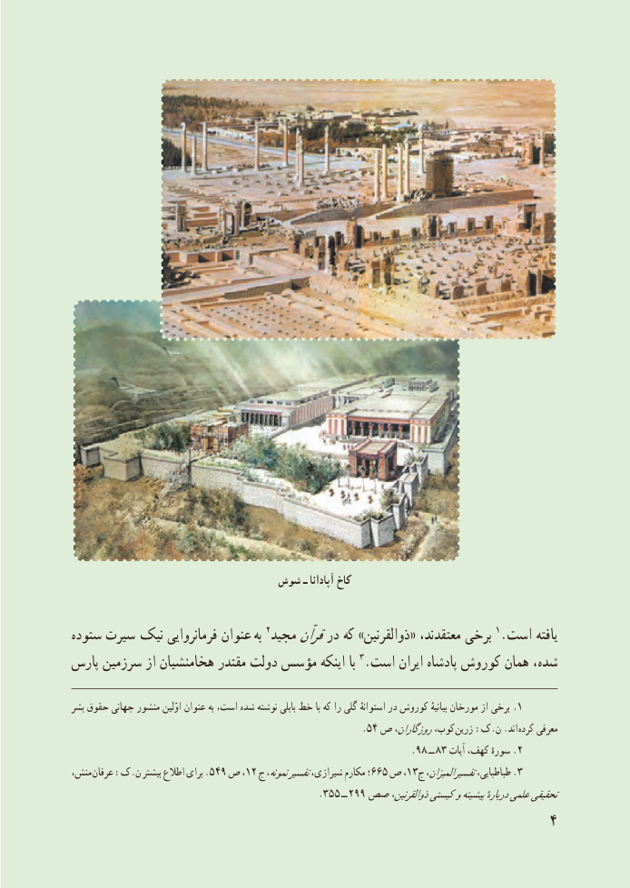

# PDF page 12

شوش ـ آپادانا کاخ

ستوده سىرت  نىک فرمانرواىى عنوان  به 2مجىد قرآندر که »ذوالقرنىن« معتقدند، برخى 1.است ىافته
پارس سرزمین از هخامنشیان مقتدر دولت مؤسس اینکه با 3.است اىران پادشاه کوروش همان شده،

بشر حقوق جهانی منشور اوّلین عنوان به است، شده نوشته بابلی خط با که را گلی استوانهٔ در کوروش بیانیهٔ مورخان از برخی .1
                                                                .٤٥ ص روزگاران،کوب، زرین :ک.ن .اند کرده معرفی
                                                                          9.8 ــ 83 آیات کهف، سورهٔ .2
،منش عرفان١٢:ک.ن بیشتر اطالع برای .٩٤٥ ص ، ج١المیزان،نمونه،تفسیرشیرازی، مکارم ٥٦٦؛ ص ، ج٣  3.تفسیرطباطبایی،
                                                      . 553 2ــ    99صص ذوالقرنین،کیستیوپیشینهدربارهٔعلمیتحقیقی
                                                            4

