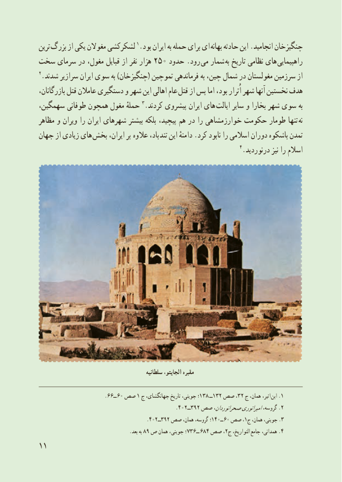

# PDF page 19

ترىن بزرگ از یکی مغوالن لشکرکشى 1.بود اىران به حمله براى اى بهانه حادثه اىن .انجامىد چنگىزخان
سخت سرماى در مغول، قباىل از نفر هزار 250 حدود .رود مى شمار به تارىخ نظامى های  راهپىماىى
2.شدند سرازىر اىران سوى به )چنگىزخان( تموچىن فرماندهى به چىن، شمال در مغولستان سرزمىن از
بازرگانان، قتل عامالن دستگىرى و شهر اىن اهالى عام  قتل از پس اما بود، اُترار شهر آنها نخستىن هدف
سهمگىن، طوفانى همچون مغول حملهٔ 3.کردند پىشروى اىران هاى اىالت ساىر و بخارا شهر سوى به
مظاهر و وىران را اىران شهرهاى بىشتر بلکه پىچىد، هم در را خوارزمشاهى حکومت طومار تنها  نه
جهان از زىادى هاى بخش اىران، بر  عالوه باد، تند اىن دامنهٔ .کرد نابود را اسالمى دوران باشکوه تمدن
                                                                   4.درنوردىد نىز را اسالم

                                              سلطانیه الجایتو، مقبره

                           .ــ٦٦ ٠٦١صص  ج جهانگشای، تاریخ جوینی، ؛138 ــ132 صص ،32 ج همان، اثىر، .ابن 1
                                              .402ــ392 صص صحرانوردان،امپراتورىگروسه، .2
                                              .٠٤٢٩٣ــ٢ صص١ــ٠٤همان، گروسه، ؛           ٠٦١صص ، ج همان، جوىنى، 3.
                                     .بعد٨ــ٦٣٧؛به ٩ ص همان جوینی،             ٦٨،٤٢التواریخ،صص  ج   4.جامع همدانی،
11

