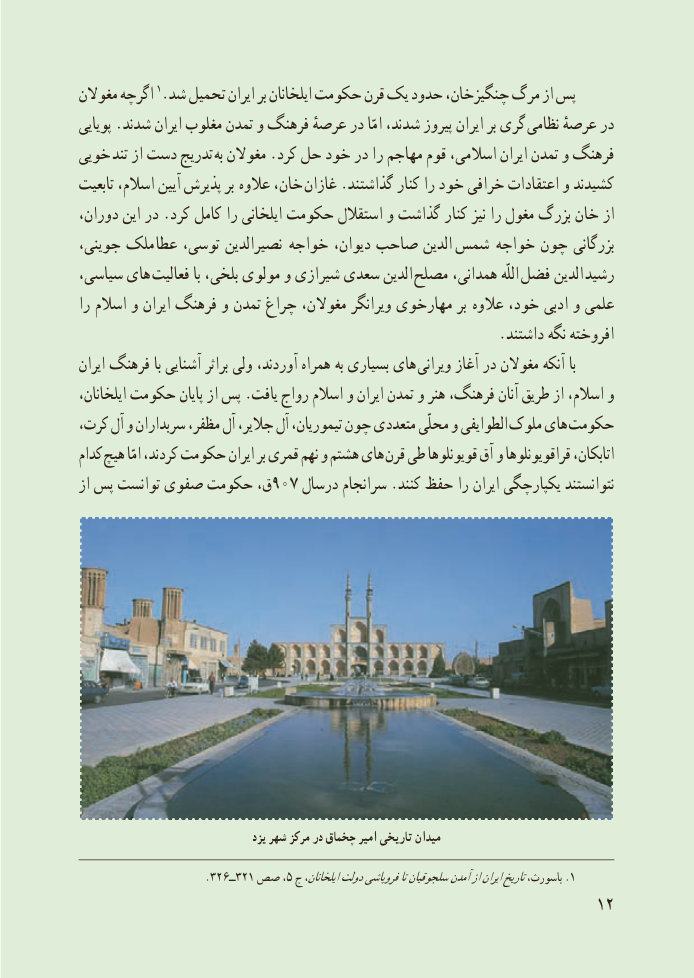

# PDF page 20

مغوالن اگرچه 1.شد تحمىل اىران بر اىلخانان حکومت قرن ىک حدود چنگىزخان، مرگ از پس
پوىاىى .شدند اىران مغلوب تمدن و فرهنگ عرصهٔ در امّا شدند، پىروز اىران بر گرى  نظامى عرصهٔ در
خوىى تند از دست تدرىج به مغوالن .کرد حل خود در را مهاجم قوم اسالمى، اىران تمدن و فرهنگ
تابعىت اسالم، آىىن پذىرش بر  عالوه خان، غازان .گذاشتند کنار را خود خرافى اعتقادات و کشىدند
دوران، اىن در .کرد کامل را اىلخانى حکومت استقالل و گذاشت کنار نىز را مغول بزرگ خان از
جوىنى، ملک  عطا توسى، نصىرالدىن  خواجه دىوان، صاحب الدىن  شمس  خواجه چون بزرگانى
سىاسى، هاى  فعالىت با بلخى، مولوى و شىرازى سعدى الدىن مصلح همدانى، اللّه  فضل الدىن  رشىد
را اسالم و اىران فرهنگ و تمدن چراغ مغوالن، وىرانگر مهارخوى بر  عالوه خود، ادبى و علمى
                                                          .داشتند نگه افروخته
اىران فرهنگ با آشناىى براثر ولى آوردند، همراه به بسىارى هاى وىرانى آغاز در مغوالن آنکه با
اىلخانان، حکومت پاىان از پس .ىافت رواج اسالم و اىران تمدن و هنر فرهنگ، آنان طرىق از اسالم، و
کرت، آل و سربداران مظفر، آل جالىر، آل تىمورىان، چون متعددى محلّى و الطواىفى ملوک هاى حکومت
کدام هىچ امّا کردند، حکومت اىران بر قمری نهم و هشتم هاى قرن طى قوىونلوها آق و قراقوىونلوها اتابکان،
از پس توانست صفوى حکومت ق،907 درسال سرانجام .کنند حفظ را اىران ىکپارچگى نتوانستند

                                      یزد شهر مرکز در چخماق امیر تاریخی میدان

                         .٣٢٣ــ٦٢١ صص ،5 ج اىلخانان،دولتفروپاشىتاسلجوقىانآمدنازاىرانتارىخباسورث، .1
                                                           12

