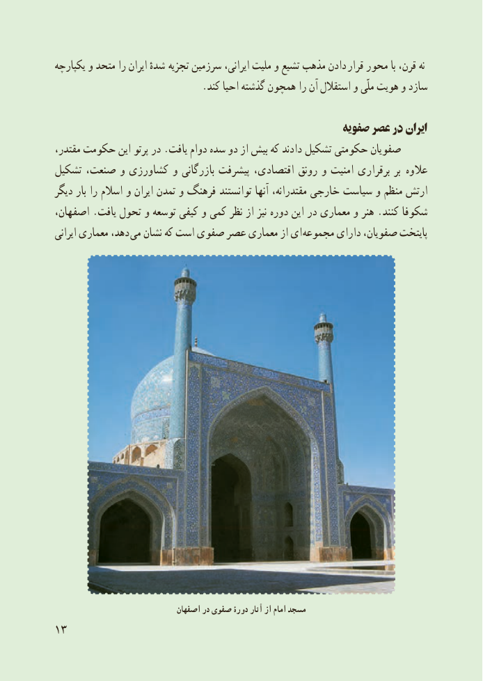

# PDF page 21

ىکپارچه و متحد را اىران شدهٔ   تجزىه سرزمىن اىرانى، ملىت و تشىع مذهب دادن  قرار محور با قرن، نه
                              .کند احىا گذشته همچون را آن استقالل و ملّى هوىت و سازد

                                                      صفوىه عصر در اىران
مقتدر، حکومت اىن پرتو در .ىافت دوام سده دو از بىش که دادند تشکىل حکومتى صفوىان
تشکىل صنعت، و کشاورزى و بازرگانى پىشرفت اقتصادى، رونق و امنىت برقرارى بر   عالوه
دىگر بار را اسالم و اىران تمدن و فرهنگ توانستند آنها مقتدرانه، خارجى سىاست و منظم ارتش
اصفهان، .ىافت تحول و توسعه کىفى و کمى نظر از نىز دوره اىن در معمارى و هنر .کنند شکوفا
اىرانى معمارى دهد،  مى نشان که است صفوى عصر معمارى از اى مجموعه داراى صفوىان، پاىتخت

                               اصفهان در صفوی دورۀ آثار از امام مسجد
13

