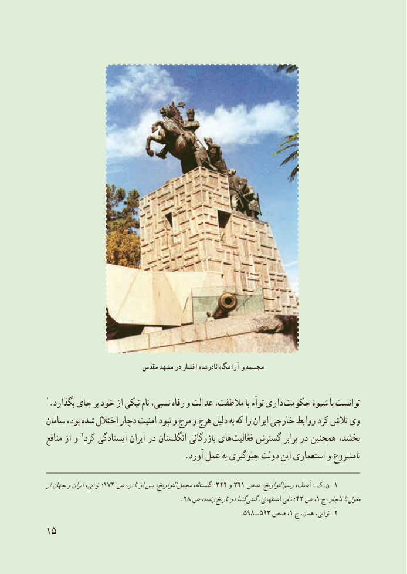

# PDF page 23

مقدس مشهد در افشار نادرشاه آرامگاه و مجسمه

 1.بگذارد جاى بر خود از نىکى نام نسبى، رفاه و عدالت مالطفت، با توأم دارى حکومت شىوهٔ با توانست
سامان بود، شده اختالل دچار امنىت نبود و مرج و هرج دلىل به که را اىران خارجى روابط کرد تالش وى
 منافع از و 2کرد اىستادگى اىران در انگلستان بازرگانى هاى فعّالىت گسترش برابر در همچنىن بخشد،
                                   .آورد عمل به جلوگىرى دولت اىن استعمارى و نامشروع

ازجهانواىراننواىى، ؛172 ص نادر،ازپسالتوارىخ، مجمل٢٢گلستانه، ٣؛  و٢١٣ صص التوارىخ، .رسمآصف، :ک.ن 1
                                       .28 ص زندىه،تارىخدرگشا گىتىاصفهانى، نامى ؛42 ص ،1 ج قاجار،تامغول
                                                              .598 ــ 593 صص ،1 ج همان، نواىى، .2
15

