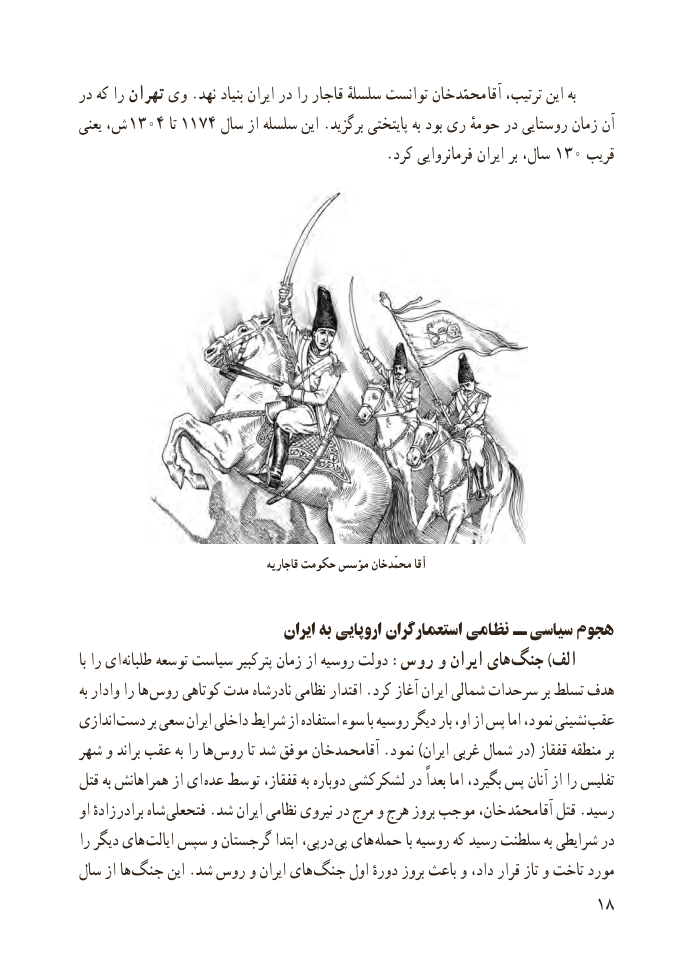

# PDF page 26

در که را تهران وی . نهد بنیاد ایران در را قاجار سلسلهٔ توانست محمّدخان  آقا ترتیب، این به
یعنی ش،  ١ ٤٠٣١١٧آنتا    ٤ سال از سلسله این . برگزید پایتختی به بود ری حومهٔ در روستایی زمان
                                            . کرد فرمانروایی ایران بر سال،   130 قریب

                                          قاجاریه حکومت مؤسس خان محمّد آقا

                                 ایران به اروپایی استعمارگران نظامی ــ سیاسی هجوم
با را ای طلبانه توسعه سیاست پترکبیر زمان از روسیه دولت :روس و ایران های جنگ )الف
به وادار را ها روس کوتاهی مدت نادرشاه نظامی اقتدار .کرد آغاز ایران شمالی سرحدات بر تسلط هدف
اندازی دست بر سعی ایران داخلی شرایط از استفاده سوء با روسیه دیگر بار او، از پس اما نمود، نشینی عقب
شهر و براند عقب به را ها روس تا شد موفق آقامحمدخان .نمود )ایران غربی شمال در( قفقاز منطقه بر
قتل به همراهانش از ای  عده توسط قفقاز، به دوباره لشکرکشی در بعداً اما بگیرد، پس آنان از را تفلیس
او زادهٔ  برادر شاه فتحعلی .شد ایران نظامی نیروی در مرج و هرج بروز موجب خان،  محمّد آقا قتل .رسید
را دیگر های  ایالت سپس و گرجستان ابتدا درپی،  پی های  حمله با روسیه که رسید سلطنت به شرایطی در
سال از ها  جنگ این .شد روس و ایران های جنگ اول دورهٔ بروز باعث و داد، قرار تاز و تاخت مورد
                                                           18

