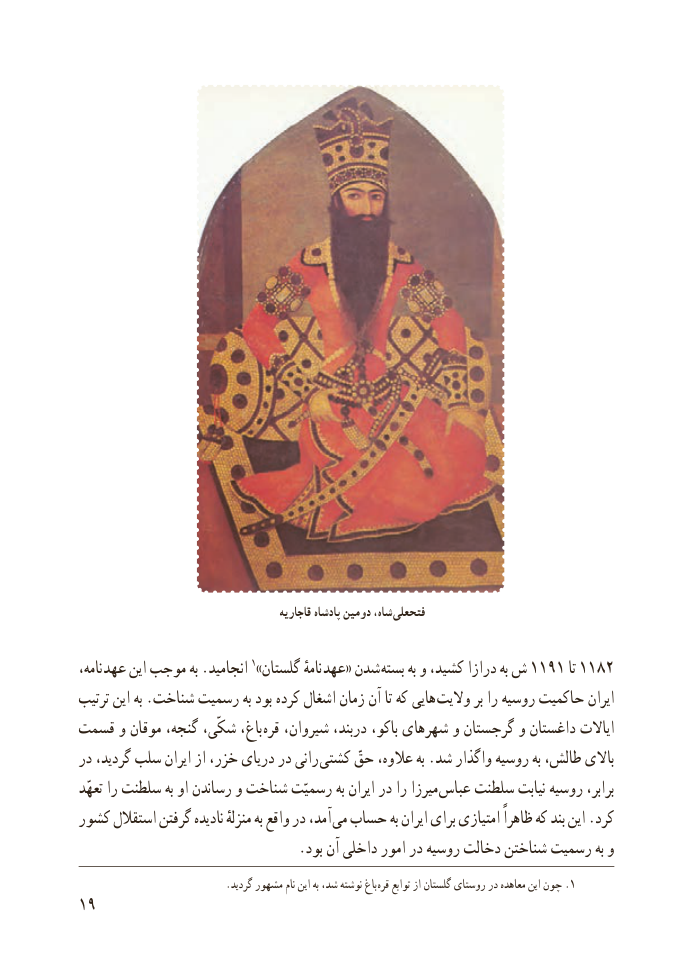

# PDF page 27

قاجاریه پادشاه دومین ،فتحعلیشاه

،نامه  عهد این موجب به .انجامید 1»گلستان نامهٔ عهد« شدن  بسته١١٩١به و کشید، درازا به ش     تا١١٨٢
ترتیب این به .شناخت رسمیت به بود کرده اشغال زمان آن تا که هایی  والیت بر را روسیه حاکمیت ایران
قسمت و موقان گنجه، شکّی، باغ، قره شیروان، دربند، باکو، شهرهای و گرجستان و داغستان ایاالت
در گردید، سلب ایران از خزر، دریای در رانی کشتی حقّ عالوه، به .شد واگذار روسیه به طالش، باالی
تعهّد را سلطنت به او رساندن و شناخت رسمیّت به ایران در را میرزا عباس سلطنت نیابت روسیه برابر،
کشور استقالل گرفتن نادیده منزلهٔ به واقع در آمد، می حساب به ایران برای امتیازی ظاهراً که بند این .کرد
                                .بود آن داخلی امور در روسیه دخالت شناختن رسمیت به و
                             .گردید مشهور نام این به شد، نوشته باغ .قره توابع از گلستان روستای در معاهده این چون 1
19

