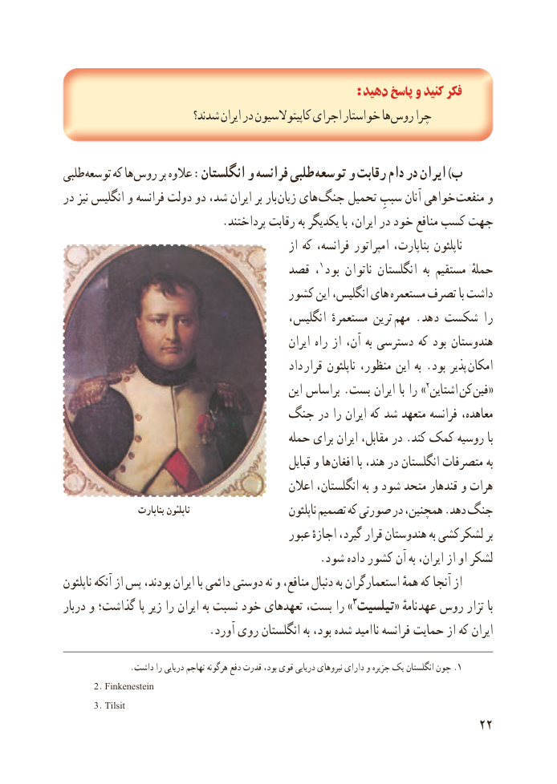

# PDF page 30

: دهید پاسخ و کنید فکر
                         شدند؟ ایران در کاپیتوالسیون اجرای خواستار ها روس چرا

طلبی توسعه که ها روس بر عالوه :انگلستان و فرانسه طلبی توسعه و رقابت دام در ایران )ب
در نیز انگلیس و فرانسه دولت دو شد، ایران بر بار زیان های جنگ تحمیل سببِ آنان خواهی  منفعت و
                            .پرداختند رقابت به یکدیگر با ایران، در خود منافع کسب جهت
                                                  از که فرانسه، امپراتور بناپارت، ناپلئون
                                قصد ، 1 بود ناتوان انگلستان  به مستقیم حملهٔ
                                    کشور این انگلیس، های مستعمره تصرف با داشت
                                          انگلیس، مستعمرهٔ ترین  مهم . دهد شکست را
                                                     ایران راه از آن، به دسترسی که بود هندوستان
                                                داد  قرار ناپلئون منظور، این به . بود پذیر  امکان
                                                 این براساس .بست ایران با را »2اشتاین  کن  «فین
                           جنگ در را ایران که شد متعهد فرانسه معاهده،
                                          حمله برای ایران مقابل، در .کند کمک روسیه با
                                                    قبایل و ها  افغان با هند، در انگلستان متصرفات به
                                              اعالن انگلستان، به و شود متحد قندهار و هرات
                    بناپارت ناپلئون                                                         ناپلئون تصمیم که صورتی در همچنین، .دهد جنگ
                                          عبور اجازهٔ گیرد، قرار هندوستان به کشی  لشکر بر
                                               .شود داده کشور آن به ایران، از او لشکر
ناپلئون آنکه از پس بودند، ایران با دائمی دوستی نه و منافع، دنبال به استعمارگران همهٔ که آنجا از
دربار و گذاشت؛ پا زیر را ایران به نسبت خود تعهدهای بست، را »3 تیلسیت« نامهٔ عهد روس تزار با
                          .آورد روی انگلستان به بود، شده امید  نا فرانسه حمایت از که ایران

..داشت را دریایی تهاجم هرگونه دفع قدرت بود، قوی دریایی نیروهای دارای و جزیره یک انگلستان چون 1
       2. Finkenestein
       3. Tilsit
                                                           22

