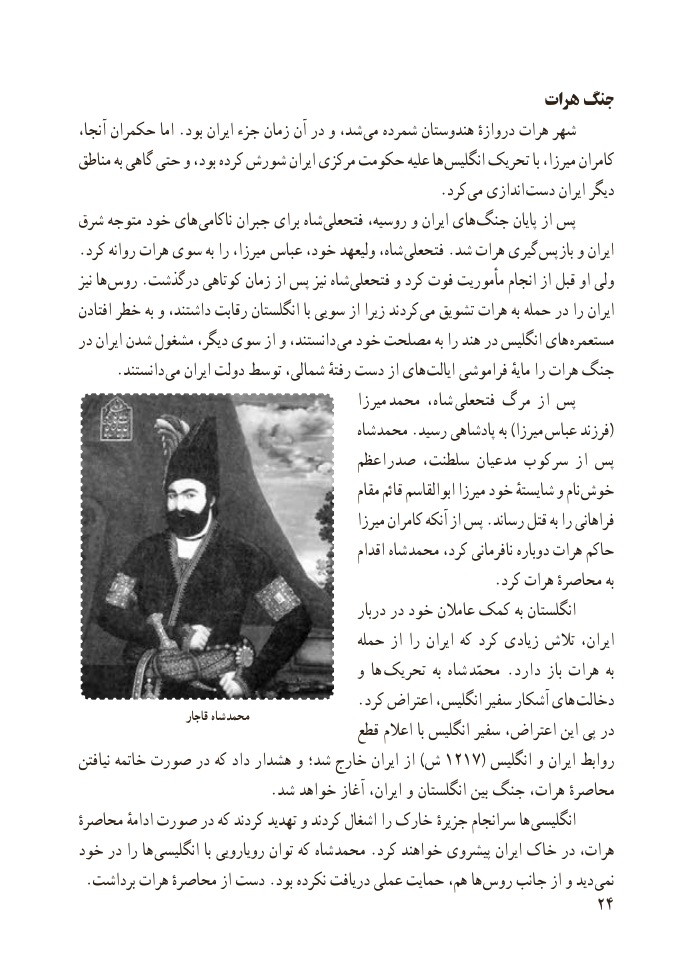

# PDF page 32

هرات جنگ
آنجا، حکمران اما .بود ایران جزء زمان آن در و شد، می شمرده هندوستان دروازهٔ هرات شهر
مناطق به گاهی حتی و بود، کرده شورش ایران مرکزی حکومت علیه ها  انگلیس تحریک با میرزا، کامران
                                                    .کرد  می اندازی دست ایران دیگر
شرق متوجه خود های ناکامی جبران برای شاه فتحعلی روسیه، و ایران های جنگ پایان از پس
.کرد روانه هرات سوی به را میرزا،  عباس خود، ولیعهد شاه، فتحعلی .شد هرات گیری پس باز و ایران
نیز ها روس .درگذشت کوتاهی زمان از پس نیز شاه فتحعلی و کرد فوت مأموریت انجام از قبل او ولی
افتادن خطر به و داشتند، رقابت انگلستان با سویی از زیرا کردند می تشویق هرات به حمله در را ایران
در ایران شدن مشغول دیگر، سوی از و دانستند،  می خود مصلحت به را هند در انگلیس های مستعمره
     .دانستند می ایران دولت توسط شمالی، رفتهٔ دست از های ایالت فراموشی مایهٔ را هرات جنگ
                                                میرزا  محمد شاه،  فتحعلی مرگ از پس
                                             شاه محمد .رسید پادشاهی به )میرزا  (عباس فرزند
                                 صدراعظم سلطنت، مدعیان سرکوب از پس
                                                  مقام قائم ابوالقاسم میرزا خود شایستهٔ و نام خوش
                                                  میرزا کامران آنکه از پس .رساند قتل به را فراهانی
                                                  اقدام شاه محمد کرد، نافرمانی دوباره هرات حاکم
                                                           .کرد هرات محاصرهٔ به
                                                 دربار در خود عامالن کمک به انگلستان
                                         حمله از را ایران که کرد زیادی تالش ایران،
                                        و ها  تحریک  به شاه  محمّد . دارد باز هرات  به
                                        . کرد اعتراض انگلیس، سفیر آشکار های  دخالت                       قاجار شاه محمد
                                       قطع اعالم با انگلیس سفیر اعتراض، این پی در
نیافتن خاتمه صورت در که داد هشدار و شد؛ خارج ایران از ) ش ١٢١٧ ( انگلیس و ایران روابط
                           . شد خواهد آغاز ایران، و انگلستان بین جنگ هرات، محاصرهٔ
محاصرهٔ ادامهٔ صورت در که کردند تهدید و کردند اشغال را خارک  جزیرهٔهاسرانجام     انگلیسی
خود در را ها  انگلیسی با رویارویی توان که شاه محمد .کرد خواهند پیشروی ایران خاک در هرات،
 .برداشت هرات محاصرهٔ از دست .بود نکرده دریافت عملی حمایت هم، ها روس جانب از و دید نمی
                                                           24

