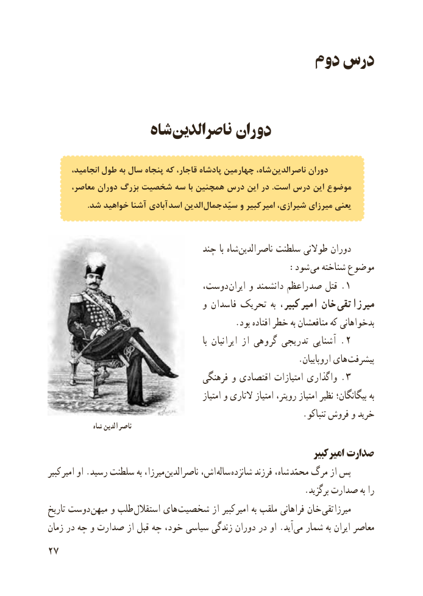

# PDF page 35

دوم درس

              شاه ناصرالدین دوران

       انجامید، طول به سال پنجاه که قاجار، پادشاه چهارمین شاه، ناصرالدین دوران
      معاصر، دوران بزرگ شخصیت سه با همچنین درس این در .است درس این موضوع
                   .شد خواهید آشنا آبادی  اسد الدین  جمال سیّد و کبیر  امیر شیرازی، میرزای یعنی

                                  چند با شاه الدین ناصر سلطنت طوالنی دوران
                                             :شود  می شناخته موضوع
                              دوست،  ایران و دانشمند راعظم  .صد قتل    ١
                                     و فاسدان تحریک  به کبیر،  امیر خان  تقی  میرزا
                                            .بود افتاده خطر به منافعشان که بدخواهانی
                                                                      با ایرانیان از گروهی تدریجی آشنایی .  ٢
                                                           .اروپاییان های  پیشرفت
                                    فرهنگی و اقتصادی امتیازات واگذاری .  ٣
                                                  امتیاز و التاری امتیاز رویتر، امتیاز نظیر بیگانگان؛ به
                                                            .تنباکو فروش و خرید
               شاه الدین ناصر
                                                                       کبیر امیر صدارت
کبیر امیر او .رسید سلطنت به میرزا، ناصرالدین اش، ساله شانزده فرزند شاه،  محمّد مرگ از پس
                                                            .برگزید صدارت به را
تاریخ دوست میهن و طلب استقالل های  شخصیت از کبیر امیر به ملقب فراهانی خان تقی میرزا
زمان در چه و صدارت از قبل چه خود، سیاسی زندگی دوران در او .آید می شمار به ایران معاصر
27

