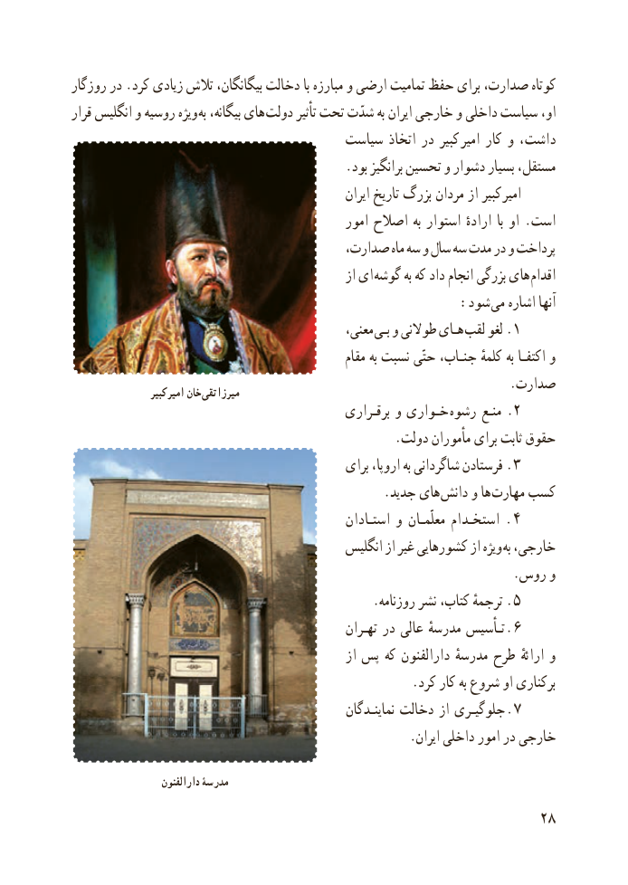

# PDF page 36

روزگار در .کرد زیادی تالش بیگانگان، دخالت با مبارزه و ارضی تمامیت حفظ برای صدارت، کوتاه
قرار انگلیس و روسیه ویژه به بیگانه، های  دولت تأثیر تحت شدّت به ایران خارجی و داخلی سیاست او،
                                    سیاست اتخاذ در کبیر  امیر کار و داشت،
                                           .بود برانگیز تحسین و دشوار بسیار مستقل،
                                                         ایران تاریخ بزرگ مردان از کبیر امیر
                                                امور اصالح به استوار ارادهٔ  با او . است
                                     صدارت، ماه سه و سال سه مدت در و پرداخت
                                                      از ای  گوشه به که داد انجام بزرگی های اقدام
                                                 :شود  می اشاره آنها
                                                 معنی، بـی و طوالنی هـای لقب لغو  . ١
                                                       مقام به نسبت حتّی جنـاب، کلمهٔ به اکتفـا و
                                                                     .صدارت                   کبیر امیر خان تقی  میرزا
                                                 برقـراری و خـواری  .رشوه منـع 2
                                                   .دولت مأموران برای ثابت حقوق
                                                برای اروپا، به شاگردانی فرستادن . ٣
                                                 .جدید های دانش و ها مهارت کسب
                                                  استـادان و معلّمـان استخـدام .  ٤
                                             انگلیس از غیر کشورهایی از ویژه به خارجی،
                                                                      .روس و
                                                .روزنامه نشر کتاب، ترجمهٔ . ٥
                                                    تهـران در عالی مدرسهٔ تـأسیس  . ٦
                                                     از پس که دارالفنون مدرسهٔ طرح ارائهٔ و
                                                      .کرد کار به شروع او برکناری
                                                        نماینـدگان دخالت از جلوگیـری  . ٧
                                                      .ایران داخلی امور در خارجی

                     دارالفنون مدرسۀ
                                                           28

