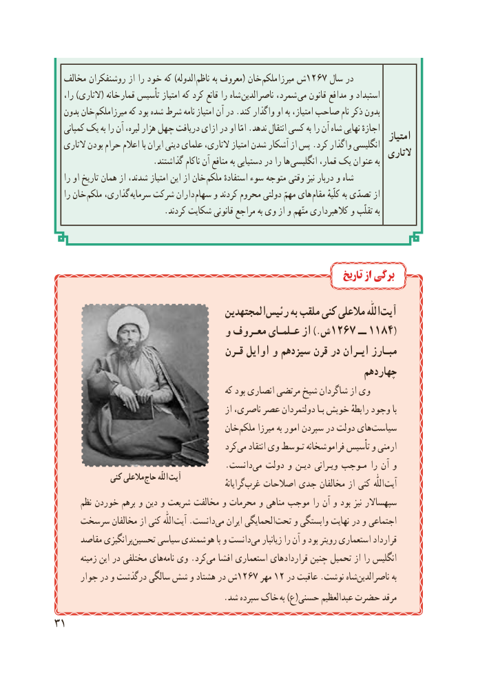

# PDF page 39

مخالف روشنفکران از را خود که )الدوله  ناظم به معروف( خان  ملکم میرزا١٢٦٧ش     سال در
   را، )التاری( خانه قمار تأسیس امتیاز که کرد قانع را شاه  ناصرالدین شمرد، می قانون مدافع و استبداد
   بدون خان  میرزاملکم که بود شده شرط نامه  امتیاز آن در .کند واگذار او به امتیاز، صاحب نام ذکر بدون
   کمپانی یک به را آن لیره، هزار چهل دریافت ازای در او امّا .ندهد انتقال کسی به را آن شاه نهایی اجازهٔ                                                                                           امتیاز   التاری بودن حرام اعالم با ایران دینی علمای التاری، امتیاز شدن  آشکار از پس .کرد واگذار انگلیسی                                                                                     التاری                        .گذاشتند ناکام آن منافع به دستیابی در را ها انگلیسی قمار، یک عنوان به
   را او تاریخ همان از شدند، امتیاز این از خان  ملکم استفادهٔ سوء متوجه وقتی نیز دربار و شاه
   را خان ملکم گذاری،  سرمایه شرکت داران  سهام و کردند محروم دولتی مهمّ های مقام کلّیهٔ به تصدّی از
                           .کردند شکایت قانونی مراجع به وی از و متّهم کالهبرداری و تقلّب به

                                                                          تاریخ از برگی

                                      المجتهدین‏رئیس به ملقب کنی مالعلی اللّٰه‏آیت
                              و معـروف عـلمـای از ).ش1267 ــ 1184(
                                     قـرن اوایل و سیزدهم قرن در ایـران مبـارز
                                                                 چهاردهم
                                             که بود انصاری مرتضی شیخ شاگردان از وی
                                                 از ناصری، عصر دولتمردان بـا خوبش رابطهٔ وجود با
                                    خان‏ملکم میرزا به امور سپردن در دولت هایسیاست‏
                                           کردمی‏   انتقاد وی تـوسط فراموشخانه تأسیس و ارمنی
                                        .دانست ‏می دولت و دیـن ویـرانی مـوجب را آن و
               کنی مالعلی حاج اللّه آیت                                                                     گرایانهٔ ‏غرب اصالحات جدی مخالفان از کنی  اللّٰه آیت
       نظم خوردن برهم و دین و شریعت مخالفت و محرمات و مناهی موجب را آن و بود نیز سپهساالر
     سرسخت مخالفان از کنی اللّٰه آیت .دانست‏می ایران الحمایگی‏تحت و وابستگی نهایت در و اجتماعی
      مقاصد برانگیزیتحسین‏     سیاسی هوشمندی با و دانست ‏می زیانبار را آن و بود رویتر استعماری قرارداد
        زمینه این در مختلفی های ‏نامه وی .کرد ‏می افشا استعماری قراردادهای چنین تحمیل از را انگلیس
      جوار در و درگذشت سالگی شش و هشتاد در ش1267 مهر 1٢ در عاقبت .نوشت شاه‏ناصرالدین به
      . شد سپرده خاک به )ع(حسنی عبدالعظیم حضرت مرقد
31

