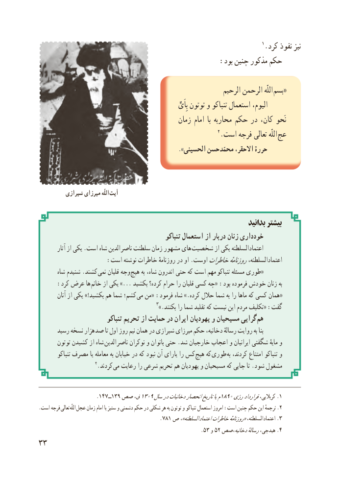

# PDF page 41

1.کرد نفوذ نیز
                                                                             :بود چنین مذکور حکم

                                                               الرحیم الرحمن اللّه  «بسم
                                                                                                        بِاَیِّ توتون و تنباکو استعمال الیوم،
                                            زمان امام  با محاربه حکم در کان، نَحو
                                                            2.است فرجه تعالی اللّه عج
                                                                         .»الحسینی حسن محمّد ،االحقر حررة

         شیرازی میرزای اللّه آیت

                                                                          بدانید بیشتر
                                                   تنباکو استعمال از دربار زنان خودداری
         آثار از یکی .است شاه الدین  ناصر سلطنت زمان مشهور های شخصیت از یکی اعتمادالسلطنه
                   :است نوشته خاطرات روزنامهٔ در او .اوستخاطراتروزنامهٔاعتمادالسلطنه،
       شاه شنیدم .کشند نمی قلیان وجه  هیچ به شاه، اندرون حتی که است مهم «تنباکو مسئله طوری
     :کرد عرض ها  خانم از یکی ...» بکشید کرده؟ حرام را قلیان کسی چه«  :بود فرموده خودش زنان به
         آنان از یکی !»بکشید هم شما کشم؛ «می من    :«فرمود شاه .»کرده حالل شما به را ماها که کسی همان
                                             3».بکنند را شما تقلید که نیست این مردم تکلیف« :گفت
                            تنباکو تحریم از حمایت در ایران یهودیان و مسیحیان گرایی  هم
      رسید نسخه هزار صد تا اول روز  نیم همان در شیرازی میرزای حکم دخانیه، رسالهٔ روایت به بنا
       توتون کشیدن از شاه  الدین  ناصر نوکران و بانوان حتی .شد خارجیان اعجاب و ایرانیان شگفتی مایهٔ و
         تنباکو مصرف یا معامله به خیابان در که نبود آن یارای را کس  هیچ که طوری  به کردند، امتناع تنباکو و
                      4.کردند  می رعایت را شرعی تحریم هم یهودیان و مسیحیان که جایی تا .شود مشغول

                    .147ــ139 صص ق،1309سالدردخانیاتانحصارتاریخیام1890رژیقراردادکربالیی، .1
.است فرجه  تعالی  اللّه .عجل زمان امام با ستیز و دشمنی حکم در شکلی هر به توتون و تنباکو استعمال امروز :است چنین حکم این ترجمهٔ 2
                                         .781 ص ،»السلطنه 3.اعتمادخاطراتروزنامهٔ«اعتمادالسلطنه،
                                                                  .٥ ٣٥٢و   دخانیه،صصرسالهٔهیدجی، 4.
33

