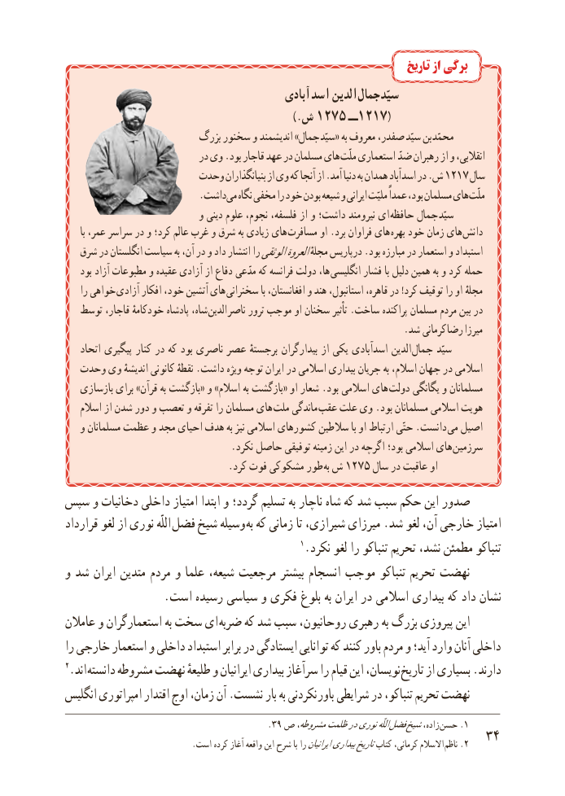

# PDF page 42

تاریخ از برگی
                                           آبادی  اسد الدین جمال سیّد
                                                   ).ش ٥٧٢١  ٧١٢١ــ (
                         بزرگ سخنور و اندیشمند »جمال سیّد« به معروف صفدر، سیّد بن محمّد
                            در وی .بود قاجار عهد در مسلمان های ملّت استعماری ضدّانقالبی،رهبران از و
                     وحدت بنیانگذاران از وی که آنجا از .آمد دنیا به همدان آباد اسد١٢١٧در .ش     سال
         .​داشتمی نگاه مخفی را خود بودن شیعه و ایرانی ملیّت عمداً بود، مسلمان های ملّت
                             و دینی علوم نجوم، فلسفه، از و داشت؛ نیرومند ای حافظه جمال سیّد
      با عمر، سراسر در و کرد؛ عالم غرب و شرق به زیادی های مسافرت او .برد فراوان های بهره خود زمان های دانش
   شرق در انگلستان سیاست به آن، در و داد انتشار راالوثقیالعروةمجلهٔ درپاریس .بود مبارزه در استعمار و استبداد
    بود آزاد مطبوعات و عقیده آزادی از دفاع مدّعی که فرانسه دولت ها، انگلیسی فشار با دلیل همین به و کرد حمله
    را خواهی  آزادی افکار خود، آتشین های سخنرانی با افغانستان، و هند استانبول، قاهره، در !کرد توقیف را او  ٔمجله
   توسط قاجار، خودکامهٔ پادشاه شاه،  الدین ناصر ترور موجب او سخنان تأثیر .ساخت پراکنده مسلمان مردم بین در
                                                                        .شد کرمانی رضا میرزا
    اتحاد پیگیری کنار در که بود ناصری عصر برجستهٔ بیدارگران از یکی اسدآبادی الدین  جمال سیّد
  وحدت وی اندیشهٔ کانونی نقطهٔ .داشت ویژه توجه ایران در اسالمی بیداری جریان به اسالم، جهان در اسالمی
   بازسازی برای »قرآن به بازگشت« و »اسالم به بازگشت« او شعار .بود اسالمی های  دولت یگانگی و مسلمانان
    اسالم از شدن دور و تعصب و تفرقه را مسلمان های ملت ماندگی عقب علت وی .بود مسلمانان اسالمی هویت
   و مسلمانان عظمت و مجد احیای هدف به نیز اسالمی کشورهای سالطین با او ارتباط حتّی .دانست  می اصیل
 . نکرد حاصل توفیقی زمینه این در اگرچه بود؛ اسالمی های سرزمین
                                 .کرد فوت مشکوکی طور  به١٢٧٥ش      سال در عاقبت او
سپس و دخانیات داخلی امتیاز ابتدا و گردد؛ تسلیم به ناچار شاه که شد سبب حکم این صدور
قرارداد لغو از نوری اللّه فضل شیخ وسیله به که زمانی تا شیرازی، میرزای .شد لغو آن، خارجی امتیاز
                                                1.نکرد لغو را تنباکو تحریم نشد، مطمئن تنباکو
و شد ایران متدین مردم و علما شیعه، مرجعیت بیشتر انسجام موجب تنباکو تحریم نهضت
                 . است رسیده سیاسی و فکری بلوغ به ایران در اسالمی بیداری که داد نشان
عامالن و استعمارگران به سخت ای ضربه که شد سبب روحانیون، رهبری به بزرگ پیروزی این
را خارجی استعمار و داخلی استبداد برابر در ایستادگی توانایی که کنند باور مردم و آید؛ وارد آنان داخلی
2.اند دانسته مشروطه نهضت طلیعهٔ و ایرانیان بیداری سرآغاز را قیام این نویسان، تاریخ از بسیاری .دارند
انگلیس امپراتوری اقتدار اوج زمان، آن .نشست بار به نکردنی  باور شرایطی در تنباکو، تحریم نهضت
                                          .39 ص مشروطه،ظلمتدرنوریاللّه فضل شیخزاده،  .حسن 1
                               .است کرده آغاز واقعه این شرح با راایرانیانبیداریتاریخکتاب کرمانی، االسالم .ناظم 2  43

