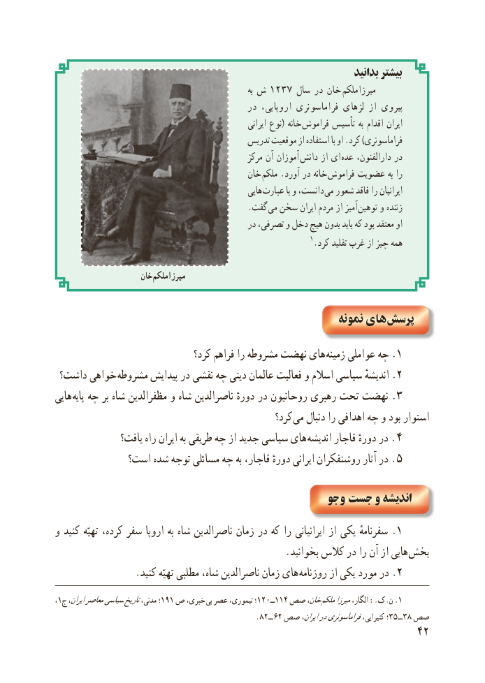

# PDF page 50

بدانید بیشتر
                                                                          به ش ١٢٣٧ سال در خان  میرزاملکم
                                           در اروپایی، فراماسونری لژهای از پیروی
                                                               ایرانی نوع( خانه فراموش تأسیس به اقدام ایران
                                           تدریس موقعیت از استفاده با او .کرد )فراماسونری
                                                    مرکز آن آموزان دانش از ای عده دارالفنون، در
                                          خان ملکم .آورد در خانه فراموش عضویت به را
                                                     هایی عبارت با و دانست، می شعور فاقد را ایرانیان
                                              .گفت می سخن ایران مردم از آمیز توهین و زننده
                                               در تصرفی، و دخل هیچ بدون باید که بود معتقد او
                                                                  1.کرد تقلید غرب از چیز همه

                       خان میرزاملکم

                                                          نمونه های پرسش
                                کرد؟ فراهم را مشروطه نهضت هاى .زمىنه عواملى چه 1
 داشت؟ خواهى .مشروطه پىداىش در نقشى چه دىنى عالمان فعالىت و اسالم سىاسى اندىشهٔ 2
هایی  .پایه چه بر شاه مظفرالدین و شاه ناصرالدین دورهٔ در روحانیون رهبری تحت نهضت 3
                                                   کرد؟ می دنبال را اهدافی چه و بود استوار
               ىافت؟ راه اىران به طرىقى چه از جدىد سىاسى هاى .اندىشه قاجار دورهٔ در    ٤
             است؟ شده توجه مسائلى چه به قاجار، دورهٔ اىرانى روشنفکران آثار در . ٥

                                               جو و  جست و اندىشه
و کنىد تهىّه کرده، سفر اروپا به شاه ناصرالدىن زمان در که را اىرانىانى از ىکى .سفرنامه 1
                                               .بخوانىد کالس در را آن از هاىى بخش
 . کنىد تهىّه مطلبى شاه، ناصرالدىن زمان هاى روزنامه از ىکى مورد در .2
،١؛ج١٩١ایران،معاصرسیاسیتاریخمدنی،  ص خبری، بی١٢٠ــ١١٤عصر تیموری، ؛    صص خان، .ملکممیرزاالگار، .:ک.ن 1
                                                 .82ــ 62 صص٣ــ٥ایران،درفراماسونریکتیرایی، ؛        ٣٨ صص
                                                           42

