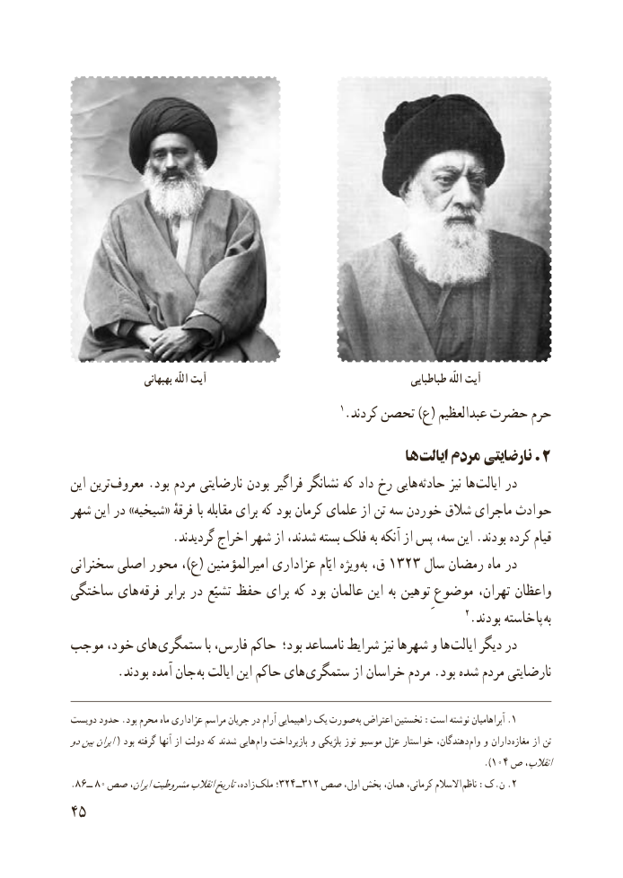

# PDF page 53

بهبهانی اللّه آیت                                              طباطبایی اللّه آیت
                                                  1.کردند تحصن )ع( عبدالعظىم حضرت حرم
                                                    ها .ایالت مردم نارضایتی 2
 اىن ترىن  معروف .بود مردم نارضاىتى بودن فراگىر نشانگر که داد رخ هاىى حادثه نىز ها  اىالت در
شهر اىن در »شىخىه« فرقهٔ با مقابله براى که بود کرمان علماى از تن سه خوردن شالق ماجراى حوادث
                 .گردىدند اخراج شهر از شدند، بسته فلک به آنکه از پس سه، اىن .بودند کرده قىام
سخنرانى اصلى محور ،)ع( امىرالمؤمنىن عزادارى اىّام وىژه به١٣٢٣ق،      سال رمضان ماه در
ساختگى هاى  فرقه برابر در تشىّع حفظ براى که بود عالمان اىن به توهىن موضوعِ تهران، واعظان
                                                                         2.بودند خاسته  پا به
موجب خود، هاى ستمگرى با فارس، حاکم بود؛ نامساعد شراىط نىز شهرها و ها  اىالت دىگر در
        .بودند آمده جان به ایالت این حاکم هاى ستمگرى از خراسان مردم .بود شده مردم نارضایتی

 دوىست حدود .بود محرم ماه عزادارى مراسم جرىان در آرام راهپىماىى ىک صورت .به اعتراض نخستىن :است نوشته آبراهامىان 1
دوبىناىران( بود گرفته آنها از دولت که شدند هاىى وام بازپرداخت و بلژىکى نوز موسىو عزل خواستار دهندگان،  وام و داران  مغازه از تن
                                                                                     ).104 ص انقالب،
 .8ــ٦  8 ٠ صص اىران،مشروطىتانقالبتاریخزاده، ملک ؛324ــ312 صص اول، بخش همان، کرمانی، االسالم  .ناظم :ک.ن 2
45

