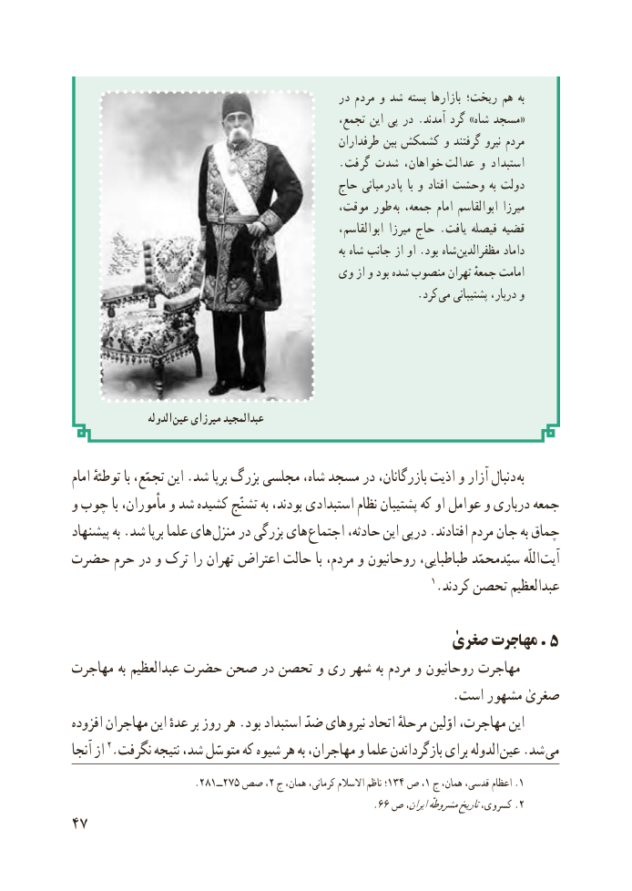

# PDF page 55

در مردم و شد بسته بازارها رىخت؛ هم به
                                                  تجمع، اىن پى در . آمدند گرد » شاه مسجد «
                                                     طرفداران بىن کشمکش و گرفتند نىرو مردم
                                                 . گرفت شدت خواهان،  عدالت و استبداد
                                           حاج مىانى  در  پا  با و افتاد وحشت به دولت
                                             موقت، طور  به جمعه، امام ابوالقاسم مىرزا
                                                            ابوالقاسم، مىرزا حاج . ىافت فىصله قضىه
                                                                               به شاه جانب از او .بود شاه مظفرالدین داماد
                                    وى از و بود شده منصوب تهران جمعهٔ امامت
                              . کرد مى پشتىبانى دربار، و

                   الدوله عین میرزای عبدالمجید

امام توطئهٔ با تجمّع، اىن .شد برپا بزرگ مجلسى شاه، مسجد در بازرگانان، اذیت و آزار دنبال به
و چوب با مأموران، و شد کشىده تشنّج به بودند، استبدادى نظام پشتىبان که او عوامل و دربارى جمعه
پىشنهاد به .شد برپا علما هاى  منزل در بزرگى هاى اجتماع حادثه، اىن درپى .افتادند مردم جان به چماق
حضرت حرم در و ترک را تهران اعتراض حالت با مردم، و روحانیون طباطباىى، سىّدمحمّد اللّه آىت
                                                                 1.کردند تحصن ٰعبدالعظىم

                                           صغری مهاجرت . ٥
مهاجرت به عبدالعظیم حضرت صحن در تحصن و ری شهر به مردم و روحانیون مهاجرت
                                                            .است مشهور صغریٰ
افزوده مهاجران اىن عدهٔ بر روز هر .بود استبداد ضدّ نىروهاى اتحاد مرحلهٔ اوّلىن مهاجرت، اىن
آنجا از 2.نگرفت نتىجه شد، متوسّل که شىوه هر به مهاجران، و علما بازگرداندن براى الدوله عىن .شد مى
                       .281ــ275 صص ،2 ج همان، کرمانی، االسالم ناظم ؛134 ص١، ج همان، قدسی، اعظام .1
                                                        .66 ص اىران،مشروطهٔتارىخکسروی، .2
47

