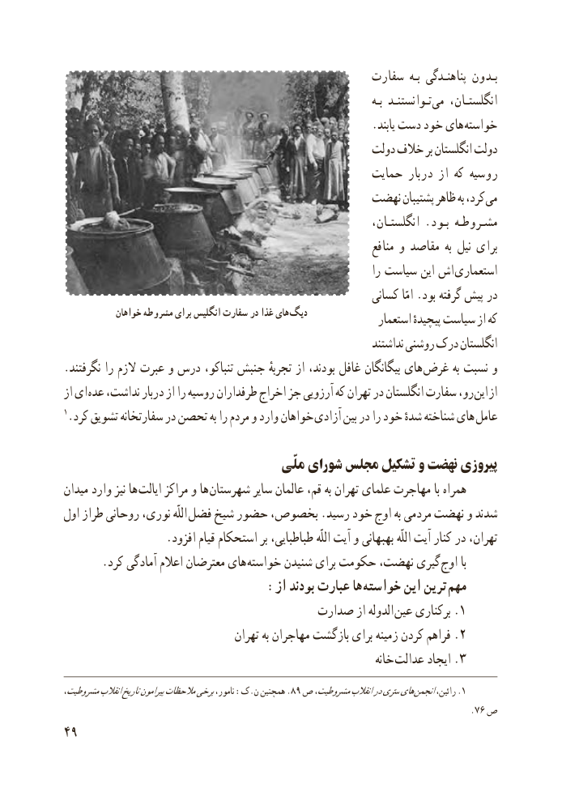

# PDF page 57

سفارت  بـه پناهنـدگى بـدون
                                                                                        بـه تـوانستنـد مى    انگلستـان،
                                                        .ىابند دست خود هاى خواسته
                                                     دولت خالف بر انگلستان دولت
                                                  حماىت دربار از که روسىه
                                          نهضت پشتىبان ظاهر به کرد، مى
                                                                 انگلستـان، . بـود مشـروطـه
                                                                      منافع و مقاصد  به نىل براى
                                                                     را سیاست این اش  استعماری
                                                         کسانى امّا .بود گرفته پىش در
            خواهان مشروطه برای انگلیس سفارت در غذا های دیگ               استعمار پىچىدهٔ سىاست از که
                                                                    نداشتند روشنى درک انگلستان
.نگرفتند را الزم عبرت و درس تنباکو، جنبش تجربهٔ از بودند، غافل بىگانگان هاى غرض به نسبت و
از اى عده نداشت، دربار از را روسیه طرفداران اخراج جز آرزوىى که تهران در انگلستان سفارت رو، اىن از
1.کرد تشوىق سفارتخانه در تحصن به را مردم و وارد خواهان  آزادى بین در را خود شدهٔ شناخته هاى  عامل

                                      ملّى شورای مجلس تشکىل و نهضت پىروزی
مىدان وارد نىز ها اىالت مراکز و ها  شهرستان ساىر عالمان قم، به تهران علماى مهاجرت با همراه
اول طراز روحانى نورى، اللّه فضل شىخ حضور بخصوص، .رسىد خود اوج به مردمى نهضت و شدند
                  .افزود قىام استحکام بر طباطبایی، اللّه آیت و بهبهانی اللّه آیت کنار در تهران،
       .کرد آمادگى اعالم معترضان هاى خواسته شنىدن براى حکومت نهضت، گىرى اوج با
    : از بودند عبارت ها خواسته اىن ترىن مهم
                                    صدارت از الدوله .عىن برکنارى 1
                                   تهران به مهاجران بازگشت براى زمىنه کردن فراهم .2
                                                                  خانه  .عدالت اىجاد 3
،مشروطىتانقالبتارىخپىرامونمالحظاتبرخىنامور، :ک.ن همچنىن .89 ص مشروطىت،انقالبدرسرّىهاى .انجمنرائین، 1
                                                                                      .76 ص
49

