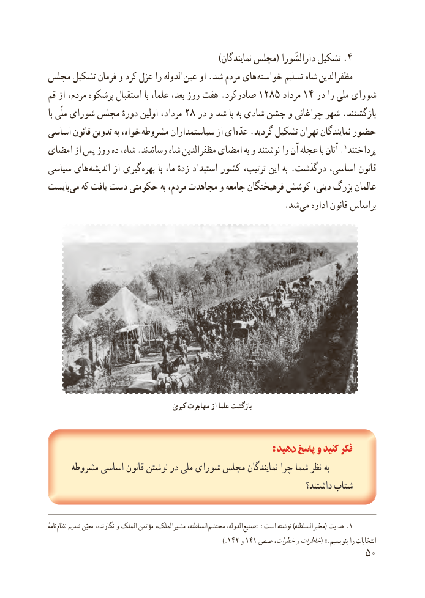

# PDF page 58

).نماىندگان مجلس( دارالشّورا تشکىل 4
مجلس تشکىل فرمان و کرد عزل را الدوله  عىن او .شد مردم هاى خواسته تسلیم شاه مظفرالدىن
قم از مردم، پرشکوه استقبال با علما، بعد، روز هفت .صادرکرد 1285 مرداد 14 در را ملى شوراى
با ملّی شورای مجلس دورهٔ اولین مرداد، 28 در و شد پا به شادى جشن و چراغانى شهر .بازگشتند
اساسى قانون تدوىن به خواه،  مشروطه سىاستمداران از اى  عدّه .گردىد تشکىل تهران نماىندگان حضور
امضاى از پس روز ده شاه، .رساندند شاه مظفرالدىن امضاى به و نوشتند را آن عجله با آنان . 1پرداختند
سىاسى هاى اندىشه از گىرى بهره با ما، زدهٔ استبداد کشور ترتىب، اىن به .درگذشت اساسى، قانون
باىست مى که ىافت دست حکومتى به مردم، مجاهدت و جامعه فرهىختگان کوشش دىنى، بزرگ عالمان
                            . شد مى اداره قانون براساس

                                     کبری مهاجرت از علما بازگشت

                                                                  : دهید پاسخ و کنید فکر
     مشروطه اساسى قانون نوشتن در ملى شوراى مجلس نماىندگان چرا شما نظر به
                                                                      داشتند؟ شتاب

ٔنامه نظام شدىم معىّن نگارنده، و الملک مؤتمن مشىرالملک، السلطنه، محتشم الدوله، .صنىع« :است نوشته )مخبرالسلطنه( هداىت 1
                                                    ).142 و 141 صصٰخطرات،وخاطرات( .»بنوىسىم را انتخابات
                                                           50

