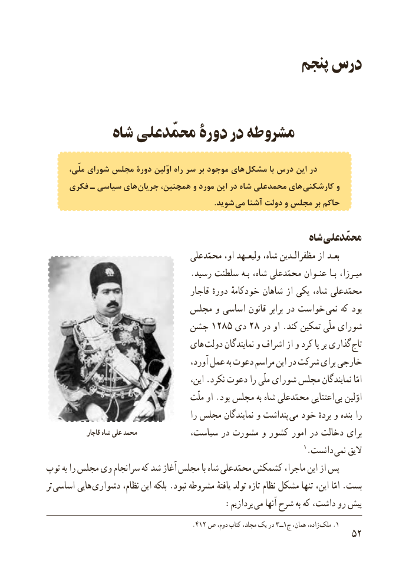

# PDF page 60

پنجم درس

          شاه محمّدعلی دورۀ در مشروطه

       ملّی، شورای مجلس دورة اوّلین راه سر بر موجود های  مشکل با درس این در
     فکری ـ سیاسی های  جریان همچنین، و مورد این در شاه محمدعلی های کارشکنی و
               . شوید می آشنا دولت و مجلس بر حاکم

                                                           شاه  محمّدعلی
                                     محمّدعلی او، ولیعـهد شاه، مظفرالـدین از بعـد
                                   .رسید سلطنت بـه شاه، محمّدعلی عنـوان بـا میـرزا،
                                       قاجار دورهٔ خودکامهٔ شاهان از یکی شاه، محمّدعلی
                          مجلس و اساسی قانون برابر در خواست  نمی که بود
                        جشن 1285 دی 28 در او .کند تمکین ملّی شورای
                               های دولت نمایندگان و اشراف از و کرد پا بر گذاری  تاج
                                        آورد، عمل به دعوت مراسم این در شرکت برای خارجی
                                          این، .نکرد دعوت را ملّی شورای مجلس نمایندگان امّا
                                          ملّت او .بود مجلس به شاه محمّدعلی اعتنایی  بی اوّلین
                                           را مجلس نمایندگان و پنداشت  می خود بردهٔ و بنده را
               قاجار شاه علی محمد                               سیاست، در مشورت و کشور امور در دخالت برای
                                                                       1.دانست  نمی الیق
توپ به را مجلس وی سرانجام که شد آغاز مجلس با شاه محمّدعلی کشمکش ماجرا، این از پس
تر اساسی هایی دشواری نظام، این بلکه .نبود مشروطه یافتهٔ تولد تازه نظام مشکل تنها این، امّا .بست
            : پردازیم می آنها شرح به که داشت، رو  پیش
                                                  .١٤٢ ص دوم، کتاب مجلد، یک در ج١ــ٣ همان، زاده، .ملک 1
                                                           52

