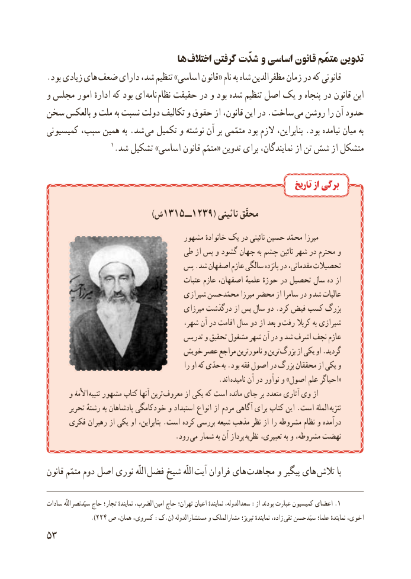

# PDF page 61

ها اختالف گرفتن شدّت و اساسی قانون متمّم تدوین
.بود زیادی های ضعف دارای شد، تنظیم »اساسی قانون« نام به شاه مظفرالدین زمان در که قانونی
و مجلس امور ادارهٔ که بود ای  نامه نظام حقیقت در و بود شده تنظیم اصل یک و پنجاه در قانون این
سخن بالعکس و ملت به نسبت دولت تکالیف و حقوق از قانون، این در .ساخت  می روشن را آن حدود
کمیسیونی سبب، همین به .شد می تکمیل و نوشته آن بر متمّمی بود الزم بنابراین، .بود نیامده میان به
                  1.شد تشکیل »اساسی قانون متمّم« تدوین برای نمایندگان، از تن شش از متشکل

                                                                          تاریخ از برگی

                )1315ش      ــ1239( نائینی محقّق
                                   مشهور خانوادهٔ یک در نائینی حسین محمّد میرزا
                              طی از پس و گشود جهان به چشم نائین شهر در محترم و
                            پس .شد اصفهان عازم سالگی پانزده در مقدماتی، تحصیالت
                                         عتبات عازم اصفهان، علمیهٔ حوزهٔ در تحصیل سال ده از
                                     شیرازی محمّدحسن میرزا محضر از سامرا در و شد عالیات
                                         میرزای درگذشت از پس سال دو .کرد فیض کسب بزرگ
                                      شهر، آن در اقامت سال دو از بعد و رفت کربال به شیرازی
                                    تدریس و تحقیق مشغول شهر آن در و شد اشرف نجف عازم
                             خویش عصر مراجع نامورترین و ترین بزرگ از یکی او .گردید
                                                را او که حدّی به .بود فقه اصول در بزرگ محققان از یکی و
    . «اند نامیده آن در نوآور و »اصول علم احیاگر
      و االُمة  تنبیه مشهور کتاب آنها ترین معروف از یکی که است مانده جای بر متعدد آثاری وی از
       تحریر رشتهٔ به پادشاهان خودکامگی و استبداد انواع از مردم آگاهی برای کتاب این .است الملة تنزیه
     فکری رهبران از یکی او بنابراین، .است کرده بررسی شیعه مذهب نظر از را مشروطه نظام و درآمده
                . رود می شمار به آن پرداز نظریه تعبیری، به و مشروطه، نهضت

قانون متمّم دوم اصل نوری اللّه فضل شیخ اللّه آیت فراوان های  مجاهدت و پیگیر های تالش با

سادات سیّدنصراللّه حاج تجار؛ نمایندهٔ الضرب، .امین حاج تهران؛ اعیان نمایندهٔ سعدالدوله، :از بودند عبارت کمیسیون اعضای 1
              .)224 ص همان، کسروی، :ک.ن( مستشارالدوله و مشارالملک تبریز؛ نمایندهٔ زاده، تقی سیّدحسن علما؛ نمایندهٔ اخوی،
53

