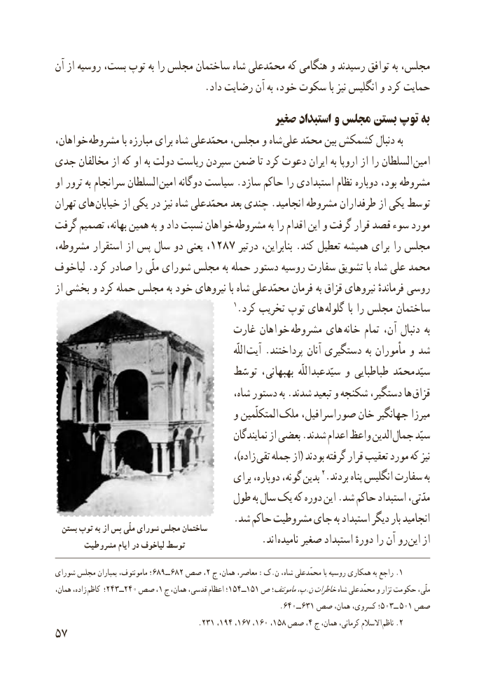

# PDF page 65

آن از روسیه بست، توپ به را مجلس ساختمان شاه محمّدعلی که هنگامی و رسیدند توافق به مجلس،
                               .داد رضایت آن به خود، سکوت با نیز انگلیس و کرد حمایت
                                          صغیر استبداد و مجلس بستن توپ به
خواهان، مشروطه با مبارزه برای شاه محمّدعلی مجلس، و شاه علی محمّد بین کشمکش دنبال به
جدی مخالفان از که او به دولت ریاست سپردن ضمن تا کرد دعوت ایران به اروپا از را السلطان  امین
او ترور به سرانجام السلطان  امین دوگانه سیاست .سازد حاکم را استبدادی نظام دوباره بود، مشروطه
تهران های خیابان از یکی در نیز شاه محمّدعلی بعد چندی .انجامید مشروطه طرفداران از یکی توسط
گرفت تصمیم بهانه، همین به و داد نسبت خواهان مشروطه به را اقدام این و گرفت قرار قصد سوء مورد
مشروطه، استقرار از پس سال دو یعنی ،1287 درتیر بنابراین، .کند تعطیل همیشه برای را مجلس
لیاخوف .کرد صادر را ملّی شورای مجلس به حمله دستور روسیه سفارت تشویق با شاه علی محمد
از بخشی و کرد حمله مجلس به خود نیروهای با شاه محمّدعلی فرمان به قزاق نیروهای فرماندهٔ روسی
                                          1.کرد تخریب توپ های گلوله با را مجلس ساختمان
                                غارت خواهان  مشروطه های  خانه تمام آن، دنبال به
                                                                         اللّه آیت .پرداختند آنان دستگیری به مأموران و شد
                                      توسّط بهبهانی، سیّدعبداللّه و طباطبایی سیّدمحمّد
                                          شاه، دستور به .شدند تبعید و شکنجه دستگیر، ها قزاق
                                     و المتکلّمین ملک صوراسرافیل، خان جهانگیر میرزا
                                               نمایندگان از بعضی .شدند اعدام واعظ الدین جمال سیّد
                                               ،)زاده تقی جمله از( بودند گرفته قرار تعقیب مورد که نیز
                                        برای دوباره، گونه،  بدین 2.بردند پناه انگلیس سفارت به
                               طول به سال یک که دوره این .شد حاکم استبداد مدّتی،
                                    .شد حاکم مشروطیت جای به استبداد دیگر بار انجامید  بستن توپ به از پس ملّی شورای مجلس ساختمان
      مشروطیت ایام در لیاخوف توسط         . اند نامیده صغیر استبداد دورهٔ را آن رو این از

شورای مجلس بمباران مامونتوف، ــ٩٨٦؛ ٦82 صص٢، ج همان، معاصر، :ک.ن شاه، محمّدعلی با روسیه همکاری به راجع .1
،زاده،همان         کاظم ؛243ــ240 صص ١، ج همان، قدسی، اعظام ؛154ــ151 ص مامونتف؛پ،.نخاطراتشاه محمّدعلی و تزار حکومت ملّی،
                   . ــ٠٤٦ ١٣٦٥ــ٣٠صص همان، کسروی، ؛           ٥صص١٠
                                         .٢١،١٣٥االسالم٤٩١، ٧٦١، ٠٦١،   ٨ صص ٤، ج همان، کرمانی،    .ناظم 2
57

