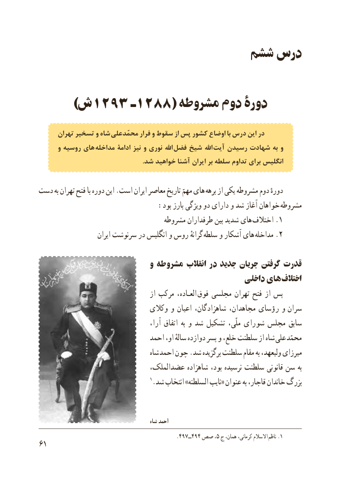

# PDF page 69

ششم درس

   )1293ش        ـ1288( مشروطه دوم دورۀ

      تهران تسخیر و شاه محمّدعلی فرار و سقوط از پس کشور اوضاع با درس این در
      و روسیه های  مداخله ادامة نیز و نوری اهلل  فضل شیخ اهلل  آیت رسیدن شهادت به و
                                                                .شد خواهید آشنا ایران بر سلطه تداوم برای انگلیس

دست به تهران فتح با دوره این .است ایران معاصر تاریخ مهمّ های برهه از یکی مشروطه دوم دورهٔ
                            :بود بارز ویژگی دو دارای و شد آغاز خواهان مشروطه
                                   مشروطه طرفداران بین شدید های .اختالف 1
                      ایران سرنوشت در انگلیس و روس گرانهٔ سلطه و آشکار های .مداخله 2

                             و مشروطه انقالب در جدید جریان گرفتن قدرت
                                                   داخلی های اختالف
                                       از مرکب العـاده،  فوق مجلسی تهران فتح از پس
                               وکالی و اعیان شاهزادگان، مجاهدان، رؤسای و   سران
                                         آرا، اتفاق به و شد تشکیل ملّی، شورای مجلس سابق
                               احمد او، سالهٔ دوازده پسر و خلع، سلطنت از شاه علی محمّد
                                     شاه احمد چون .شد برگزیده سلطنت مقام به ولیعهد، میرزای
                             عضدالملک، شاهزاده بود، نرسیده سلطنت قانونی سن به
                                      1.شد انتخاب »السلطنه نایب« عنوان به قاجار، خاندان بزرگ

                                              شاه احمد
                                               .497ــ494 صص٥، ج همان، کرمانی، االسالم  .ناظم 1
16

