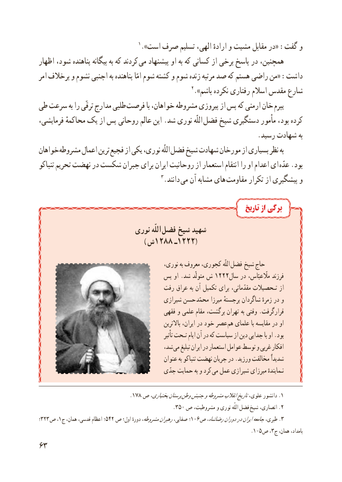

# PDF page 71

1.»است صرف تسلیم الهی، ارادهٔ و مشیت مقابل در« :گفت و
اظهار شود، پناهنده بیگانه به که کردند می پیشنهاد او به که کسانی از برخی پاسخ در همچنین،
امر برخالف و نشوم اجنبی به پناهنده امّا شوم کشته و شوم زنده مرتبه صد که هستم راضی من« :داشت
                                                    2.»باشم نکرده رفتاری اسالم مقدس شارع
طی سرعت به را ترقّی مدارج طلبی  فرصت با خواهان، مشروطه پیروزی از پس که ارمنی خان یپرم
فرمایشی، محاکمهٔ یک از پس روحانی عالم این .شد نوری اللّه فضل شیخ دستگیری مأمور بود، کرده
                                                               .رسید شهادت به
خواهان مشروطه اعمال ترین فجیع از یکی نوری، اللّه فضل شیخ شهادت مورخان از بسیاری نظر به
تنباکو تحریم نهضت در شکست جبران برای ایران روحانیت از استعمار انتقام را او اعدام ای عدّه .بود
                                         3.دانند می آن مشابه های مقاومت تکرار از پیشگیری و

                                                                          تاریخ از برگی
                          نوری اللّه  فضل  شیخ شهید
                                                      ) ش1288 ـ1222(
           ،اللّهنوری به معروف کجوری،       فضل  شیخ حاج
                                پس او .شد متولّد ش 1222سال در مااّلّعبّاس، فرزند
                                    رفت عراق به آن تکمیل برای مقدّماتی، تـحصیالت از
                                          شیرازی حسن  محمّد میرزا برجستهٔ شاگردان زمرهٔ در و
                                           فقهی و علمی مقام برگشت، تهران به وقتی .قرارگرفت
                                                             باالترین ایران، در خود عصر  هم علمای با مقایسه در او
                                                                      تأثیر تـحت ایام آن در که سیاست از دین جدایی با او .بود
                                         شد، می تبلیغ ایران در استعمار عوامل توسط و غربی افکار
                                               عنوان به تنباکو نهضت جریان در .ورزید مخالفت شدیداً
                                         جدّی حمایت به و کرد می عمل شیرازی میرزای نـمایندهٔ

                               .178 ص بختیاری،پرستان .وطنجنبشومشروطهانقالبتاریخعلوی، دانشور 1
                                             .350 ص مشروطیت، و نوری اللّه فضل .شیخ انصاری، 2
؛323 ص ١،  ج همان، قدسی، اعظام  ؛٥٤٢ ص اول؛ دورهٔ مشروطه،رهبرانصفایی،  ؛106 .ص رضاشاه،دوراندرایرانجامعهطبری، 3
                                                                                      .105 ص ٣،  ج همان، بامداد،
36

