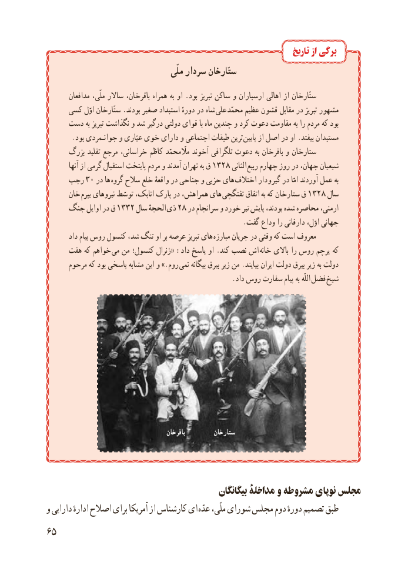

# PDF page 73

تاریخ از برگی
                                        ملّی سردار ستّارخان
        مدافعان ملّی، ساالر باقرخان، همراه به او .بود تبریز ساکن و ارسباران اهالی از ستّارخان
     کسی اوّل ستّارخان .بودند صغیر استبداد دورهٔ در شاه  علی محمّد عظیم قشون مقابل در تبریز مشهور
     دست به تبریز نگذاشت و شد درگیر دولتی قوای با ماه چندین و کرد دعوت مقاومت به را مردم که بود
       .بود جوانـمردی و عیّاری خوی دارای و اجتماعی طبقات ترین پایین از اصل در او .بیفتد مستبدان
      بزرگ تقلید مرجع خراسانی، کاظم مااّلّمحمّد آخوند تلگرافی دعوت به باقرخان و ستارخان
         آنها از گرمی استقبال پایتخت مردم و آمدند تهران به ق ٣١٢الثانی٨          ربیع چهارم روز در جهان، شیعیان
    رجب  30 در ها  گروه سالح خلع واقعهٔ در جناحی و حزبی های اختالف دار و گیر در امّا آوردند عمل به
      خان یپرم نیروهای توسّط اتابک، پارک در همراهش، های  تفنگچی اتفاق به که ستارخان ق 1328 سال
    جنگ اوایل در ق 1332 سال الحجهٔ  ذی 28 در سرانجام و خورد تیر پایش بودند، شده محاصره ارمنی،
                                                        .گفت وداع را دارفانی اوّل، جهانی
        داد پیام روس کنسول شد، تنگ او بر عرصه تبریز های مبارزه جریان در وقتی که است معروف
     هفت که خواهم  می من کنسول؛ ژنرال« :داد پاسخ او .کند نصب اش  خانه باالی را روس پرچم که
      مرحوم که بود پاسخی مشابه این و .»روم  نمی بیگانه بیرق زیر من .بیایند ایران دولت بیرق زیر به دولت
     . داد روس سفارت پیام به اللّه فضل شیخ

                                             باقرخان         ستارخان

                                                بیگانگان مداخلۀ و مشروطه نوپای مجلس
و دارایی ادارهٔ اصالح برای آمریکا از کارشناس ای عدّه ملّی، شورای مجلس دوم دورهٔ تصمیم طبق
65

