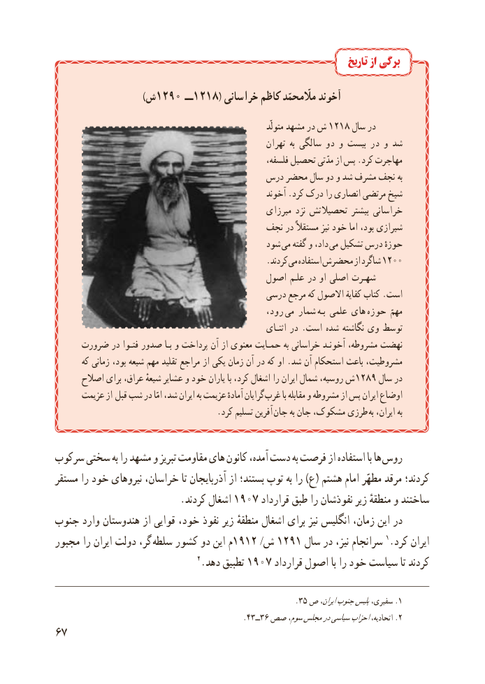

# PDF page 75

تاریخ از برگی

                            )ش1290  ــ1218( خراسانی کاظم مااّلّمحمّد آخوند
                                                                         متولّد مشهد در ش 1218 سال در
                                                       تهران  به سالگی دو و بیست در و شد
                                                         فلسفه، تحصیل مدّتی از پس .کرد مهاجرت
                                    درس محضر سال دو و شد مشرف نجف به
                                                      آخوند .کرد درک را انصاری مرتضی شیخ
                                                  میرزای نزد تحصیالتش بیشتر خراسانی
                                      نجف در مستقالً نیز خود اما بود، شیرازی
                                            شود  می گفته و داد،  می تشکیل درس حوزهٔ
                                                  .کردند می استفاده محضرش از شاگرد 1200
                                          اصول علـم در او اصلی شهـرت
                                           درسی مرجع که االصول کفایة کتاب .است
                                                  رود،  می شمار  بـه علمی های  حوزه مهمّ
                                                               اثنـای در . است شده نگاشته وی توسط
     ضرورت در فتـوا صدور بـا و پرداخت آن از معنوی حمـایت به خراسانی آخونـد مشروطه، نهضت
       که زمانی بود، شیعه مهم تقلید مراجع از یکی زمان آن در که او .شد آن استحکام باعث مشروطیت،
      اصالح برای عراق، شیعهٔ عشایر و خود یاران با کرد، اشغال را ایران شمال روسیه، ش  1289 سال در
      عزیمت از  قبل شب در امّا شد، ایران به عزیمت آمادهٔ گرایان غرب با مقابله و مشروطه از پس ایران اوضاع
      . کرد تسلیم آفرین جان به جان مشکوک، طرزی به ایران، به

سرکوب سختی به را مشهد و تبریز مقاومت های کانون آمده، دست به فرصت از استفاده با ها روس
مستقر را خود نیروهای خراسان، تا آذربایجان از بستند؛ توپ به را )ع( هشتم امام مطهّر مرقد کردند؛
        .1907کردند اشغال       قرارداد طبق را نفوذشان زیر منطقهٔ و ساختند
جنوب وارد هندوستان از قوایی خود، نفوذ زیر منطقهٔ اشغال برای نیز انگلیس زمان، این در
مجبور را ایران دولت گر، سلطه کشور دو این م1912 /ش 1291 سال در نیز، سرانجام 1.کرد ایران
                                 2.دهد تطبیق 1907 قرارداد اصول با را خود سیاست تا کردند

                                                          .35 ص ایران،جنوبپلیسسفیری، .١
                                              .43ــ36 صص٢سوم،مجلسدرسیاسیاحزاباتحادیه، .
76

