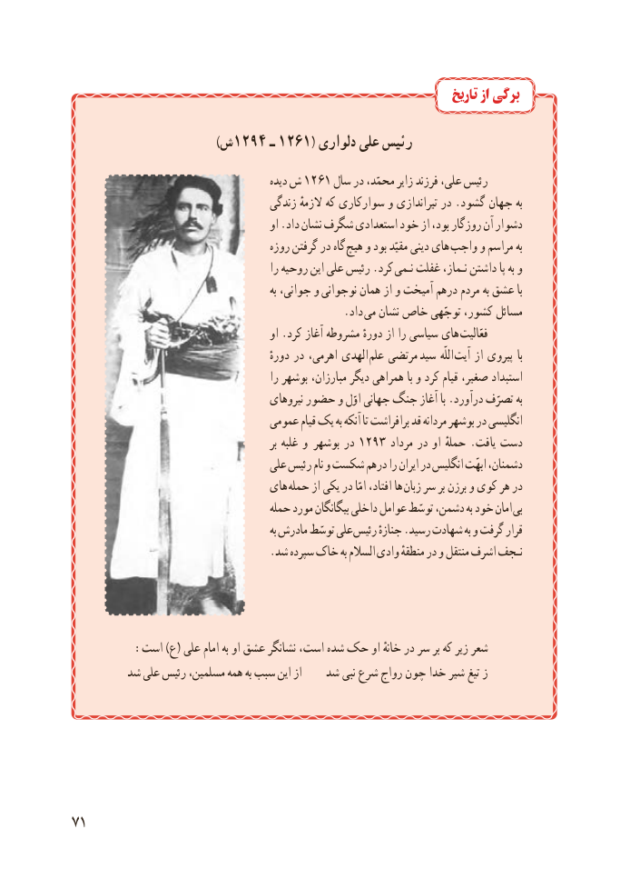

# PDF page 79

تاریخ از برگی

                                    )ش1294 ـ 1261( دلواری علی رئیس
                                              دیده ش 1261 سال در محمّد، زایر فرزند علی، رئیس
                                      زندگی الزمهٔ که سوارکاری و تیراندازی در .گشود جهان به
                                              او .داد نشان شگرف استعدادی خود از بود، روزگار آن دشوار
                                        روزه گرفتن در گاه  هیچ و بود مقیّد دینی های  واجب و مراسم به
                                             را روحیه این علی رئیس .کرد  نـمی غفلت نـماز، داشتن پا به و
                                                           به جوانی، و  نوجوانی همان از و آمیخت درهم مردم به عشق با
                                                  .داد می نشان خاص توجّهی کشور، مسائل
                                               او .کرد آغاز مشروطه دورهٔ از را سیاسی های  فعّالیت
                                                   دورهٔ در اهرمی، الهدی  علم مرتضی  سید  اللّه  آیت از پیروی  با
                                              را بوشهر مبارزان، دیگر همراهی با و کرد قیام صغیر، استبداد
                                          نیروهای حضور و اوّل جهانی جنگ آغاز با .درآورد تصرّف به
                                  عمومی قیام یک به آنکه تا برافراشت قد مردانه بوشهر در انگلیسی
                                                        بر غلبه و   بوشهر در 1293 مرداد در او حملهٔ . یافت دست
                                    علی رئیس نام و شکست درهم را ایران در انگلیس ابهّت دشمنان،
                                  های  حمله از یکی در امّا افتاد، ها  زبان سر بر برزن و کوی هر در
                                      حمله مورد بیگانگان داخلی عوامل توسّط دشمن، به خود امان بی
                                                            به مادرش توسّط علی رئیس جنازهٔ .رسید شهادت به و گرفت قرار
                                     .شد سپرده خاک به السالم وادی منطقهٔ در و منتقل اشرف نـجف

         :است )ع( علی امام به او عشق نشانگر است، شده حک او خانهٔ در سر بر که زیر شعر
        شد علی رئیس مسلمین، همه به سبب این از    شد نبی شرع رواج چون خدا شیر تیغ ز

17

