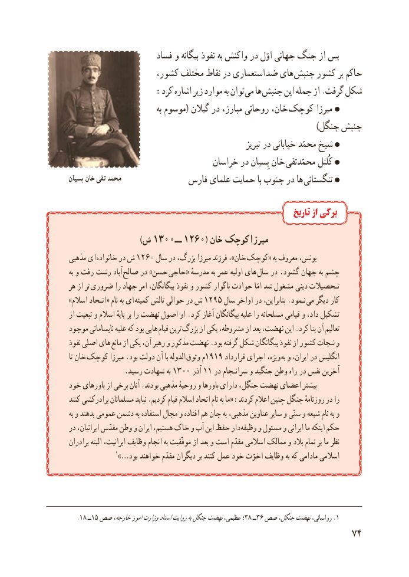

# PDF page 82

فساد و بیگانه نفوذ به واکنش در اوّل جهانی جنگ از پس
                    کشور، مختلف نقاط در استعماری ضد های جنبش کشور بر حاکم
                 :کرد اشاره زیر موارد به توان می ها جنبش این جمله از .گرفت شکل
                                  به موسوم( گیالن در مبارز، روحانی خان،  کوچک میرزا
                                                                                        )جنگل جنبش
                                                               تبریز در خیابانی محمّد شیخ
                                  خراسان در پِسیان خان محمّدتقی کُلنل
پسیان خان تقی محمد              فارس علمای حمایت با جنوب در ها تنگستانی

                                                                    تاریخ از برگی
                           )ش 1300 ــ 1260( خان   کوچک میرزا
مذهبی ای خانواده در ش 1260 سال در بزرگ، میرزا فرزند ،»خان  کوچک« به معروف یونس،
به و رفت رشت آباد  صالح در »حسن  حاجی« مدرسهٔ به عمر اولیه های سال در .گشود جهان به چشم
هر از تر ضروری را جهاد امر بیگانگان، نفوذ و کشور ناگوار حوادث امّا شد مشغول دینی تـحصیالت
»اسالم اتـحاد« نام به ای  کمیته تالش حوالی در ش 1295 سال اواخر در بنابراین، .نـمود می دیگر کار
از تبعیت و اسالم پایهٔ بر را نهضت اصول او .کرد آغاز بیگانگان علیه را مسلحانه قیامی و داد، تشکیل
موجود نابسامانی علیه که بود هایی قیام ترین بزرگ از یکی مشروطه، از بعد نهضت، این .کرد بنا آن تعالیم
نفوذ اصلی های مانع از یکی آن، رهبر و مذکور نهضت .بود گرفته شکل بیگانگان نفوذ از کشور نـجات و
تا خان کوچک میرزا .بود دولت آن با الدوله  وثوق م1919 قرارداد اجرای ویژه، به و ایران، در انگلیس
    .1300رسید شهادت به       آذر 11 در سرانـجام و جنگید وطن راه در نفس آخرین
خود باورهای از برخی آنان .بودند مذهبی روحیهٔ و باورها دارای جنگل، نهضت اعضای بیشتر
کنند برادرکشی مسلمانان نباید .کردیم قیام اسالم اتحاد نام به ما« :کردند اعالم چنین جنگل روزنامهٔ در را
به و بدهند عمومی دشمن به استفاده مجال و افتاده هم جان به مذهبی، عناوین سایر و سنّی و شیعه نام به و
در ایرانیان، مقدّس وطن و ایران هستیم، خاک و آب این حفظ دار  وظیفه و مسئول و ایرانی ما اینکه حکم
برادران البته ایرانیت، وظایف انجام به موفّقیت از بعد و است مقدّم اسالمی ممالک و بالد تمام بر ما نظر
           1»…بود خواهند مقدّم دیگران بر کنند عمل خود اخوّت وظایف به که مادامی اسالمی

   .18 ــ15 صص خارجه،اموروزارتاسنادروایتبهجنگلنهضتعظیمی، ؛38 ــ36 صص جنگل،نهضترواسانی، .1
                                                      74

