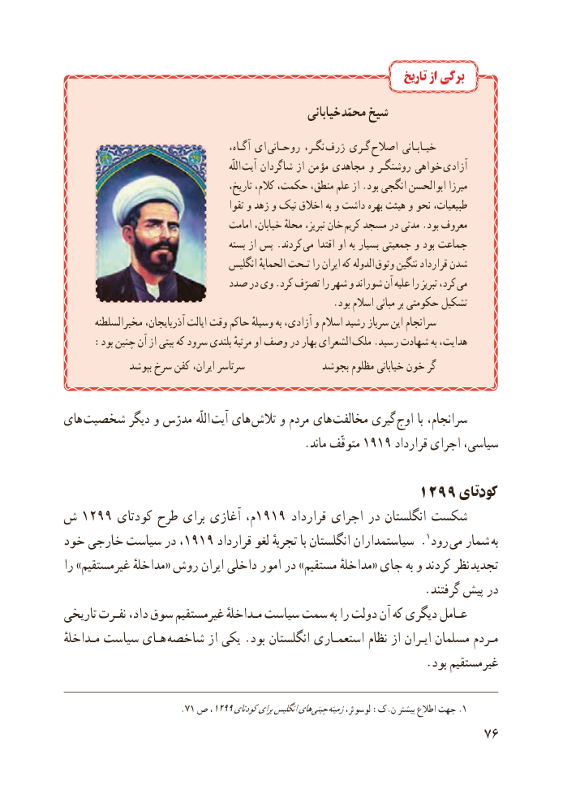

# PDF page 84

تاریخ از برگی
                                                    خیابانی  محمّد شیخ
                                              آگـاه، ای  روحـانی نگـر،  ژرف گـری  اصالح خیـابـانی
                                                                    اللّه  آیت شاگردان از مؤمن مجاهدی و روشنگـر خواهی  آزادی
                                           تاریخ، کالم، حکمت، منطق، علم از .بود انگجی ابوالحسن میرزا
                                            تقوا و زهد و نیک اخالق به و داشت بهره هیئت و نحو طبیعیات،
                                    امامت خیابان، محلهٔ تبریز، خان  کریم مسجد در مدتی .بود معروف
                                        بسته از پس .کردند می اقتدا او به بسیار جمعیتی و بود جماعت
                                   انگلیس الحمایهٔ تـحت را ایران که الدوله وثوق ننگین قرارداد شدن
                           صدد در وی .کرد تصرّف را شهر و شوراند آن علیه را تبریز کرد، می
                                                        .بود اسالم مبانی بر حکومتی تشکیل
       مخبرالسلطنه آذربایجان، ایالت وقت حاکم وسیلهٔ به آزادی، و اسالم رشید سرباز این سرانجام
: بود چنین آن از بیتی که سرود بلندی مرثیهٔ او وصف در بهار الشعرای ملک .رسید شهادت به هدایت،
               بپوشد سرخ کفن ایران، سرتاسر              بجوشد مظلوم خیابانی خون گر

های شخصیت دیگر و مدرّس اللّه آیت های تالش و مردم های  مخالفت گیری اوج با سرانجام،
                                          .ماند متوقّف 1919 قرارداد اجرای سیاسی،

                                     1299 کودتای
ش 1299 کودتای طرح برای آغازی م،1919 قرارداد اجرای در انگلستان شکست
خود خارجی سیاست در ،1919 قرارداد لغو تجربهٔ با انگلستان سیاستمداران .1رود  می شمار  به
را »غیرمستقیم مداخلهٔ« روش ایران داخلی امور در »مستقیم مداخلهٔ« جای به و کردند نظر تجدید
                                                             .گرفتند پیش در
تاریخی نفـرت داد، سوق غیرمستقیم مـداخلهٔ سیاست سمت به را دولت آن که دیگری عـامل
مـداخلهٔ سیاست هـای شاخصه از یکی .بود انگلستان استعمـاری نظام از ایـران مسلمان مـردم
                                                             .بود غیرمستقیم

                         .71 ص ،1299کودتایبرایانگلیسهای چینی .زمینهلوسوئر، :ک.ن بیشتر اطالع جهت 1
                                                           76

