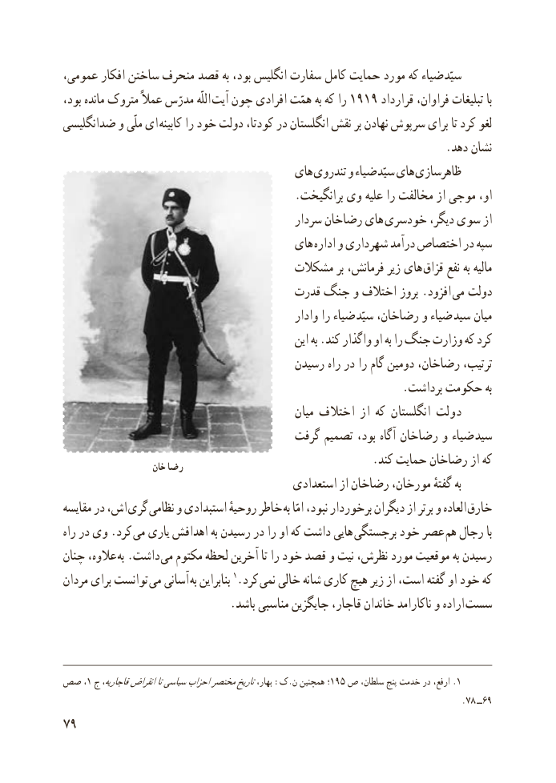

# PDF page 87

،ضیاءعمومی افکار ساختن منحرف قصد به بود، انگلیس سفارت کامل حمایت مورد که          سیّد
بود، مانده متروک عمالً مدرّس اللّه آیت چون افرادی همّت به که را 1919 قرارداد فراوان، تبلیغات با
ضدانگلیسی و ملّی ای کابینه را خود دولت کودتا، در انگلستان نقش بر نهادن سرپوش برای تا کرد لغو
                                                                    .دهد نشان
                                      های تندروی و ضیاء سیّد های ظاهرسازی
                                         .برانگیخت وی علیه را مخالفت از موجی او،
                                           سردار رضاخان های خودسری دیگر، سوی از
                                      های اداره و شهرداری درآمد اختصاص در سپه
                                    مشکالت بر فرمانش، زیر های قزاق نفع به مالیه
                                    قدرت جنگ و اختالف بروز .افزود  می دولت
                                                  وادار را ضیاء سیّد رضاخان، و ضیاء  سید میان
                                                  این به .کند واگذار او به را جنگ وزارت که کرد
                                       رسیدن راه در را گام دومین رضاخان، ترتیب،
                                                             .برداشت حکومت به
                                                 میان اختالف از که انگلستان دولت
                                     گرفت تصمیم بود، آگاه رضاخان و ضیاء  سید
                     خان رضا                                  .کند حمایت رضاخان از که
                                          استعدادی از رضاخان مورخان، گفتهٔ به
مقایسه در اش، گری نظامی و استبدادی روحیهٔ خاطر  به امّا نبود، برخوردار دیگران از برتر و العاده خارق
راه در وی .کرد می یاری اهدافش به رسیدن در را او که داشت هایی برجستگی خود عصر هم رجال با
چنان عالوه،  به .داشت می مکتوم لحظه آخرین تا را خود قصد و نیت نظرش، مورد موقعیت به رسیدن
مردان برای توانست  می آسانی به بنابراین 1.کرد نمی خالی شانه کاری هیچ زیر از است، گفته او خود که
 . باشد مناسبی جایگزین قاجار، خاندان ناکارامد و اراده سست

صص ،1 ج قاجاریه،انقراضتاسیاسیاحزابمختصرتاریخبهار، :ک.ن همچنین ؛195 ص سلطان، پنج خدمت در ارفع، .1
                                                                                                  .78 ٩٦ــ
79

