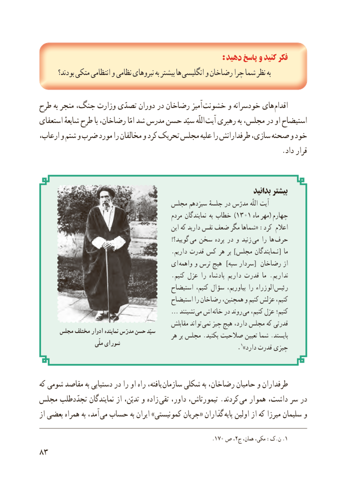

# PDF page 91

: دهید پاسخ و کنید فکر
       بودند؟ متکی انتظامی و نظامی نیروهای به بیشتر ها انگلیسی و رضاخان چرا شما نظر به

طرح به منجر جنگ، وزارت تصدّی دوران در رضاخان آمیز  خشونت و خودسرانه های اقدام
استعفای شایعهٔ طرح با رضاخان، امّا شد مدرس حسن سیّد اللّه  آیت رهبری به مجلس، در او استیضاح
ارعاب، و شتم و ضرب مورد را مخالفان و کرد تحریک مجلس علیه را طرفدارانش سازی،   صحنه و خود
                                                                   .داد  قرار

                                                                          بدانید بیشتر
                                 مجلس سیزدهم جلسهٔ در مدرّس اللّه آیت
                                                 مردم نمایندگان به خطاب )1301 ماه مهر( چهارم
                                                    این که دارید نفس ضعف مگر شماها« :کرد اعالم
                                                                 ! گویید؟  می سخن پرده در و زنید  می را ها  حرف
                                           . داریم قدرت کس هر بر ] مجلس نـمایندگان [ ما
                                     ای واهمه و ترس هیچ  ]سپه سردار[ رضاخان از
                                           . کنیم عزل را پادشاه داریم قدرت ما . نداریم
                                          استیضاح کنیم، سؤال بیاوریم، را الوزراء  رئیس
                                          استیضاح را رضاخان همچنین، و کنیم عزلش کنیم،
                   … نشینند می اش خانه در روند می کنیم، عزل کنیم؛
                                              مقابلش تواند  نمی چیز هیچ دارد، مجلس که قدرتی
      مجلس مختلف ادوار نماینده مدرّس حسن سیّد                                              هر بر مجلس .بکنید صالحیت تعیین شما .بایستد
                           ملّی شورای                                          .1»دارد قدرت چیزی

که شومی مقاصد به دستیابی در را او راه یافته،  سازمان شکلی به رضاخان، حامیان و طرفداران
مجلس تجدّدطلب نمایندگان از تدیّن، و زاده تقی داور، تیمورتاش، .کردند  می هموار داشت، سر در
از بعضی همراه به آمد، می حساب به ایران »کمونیستی جریان« گذاران  پایه اولین از که میرزا سلیمان و

                                                          .170 ص ،2.ج همان، مکی، :ک.ن 1
83

