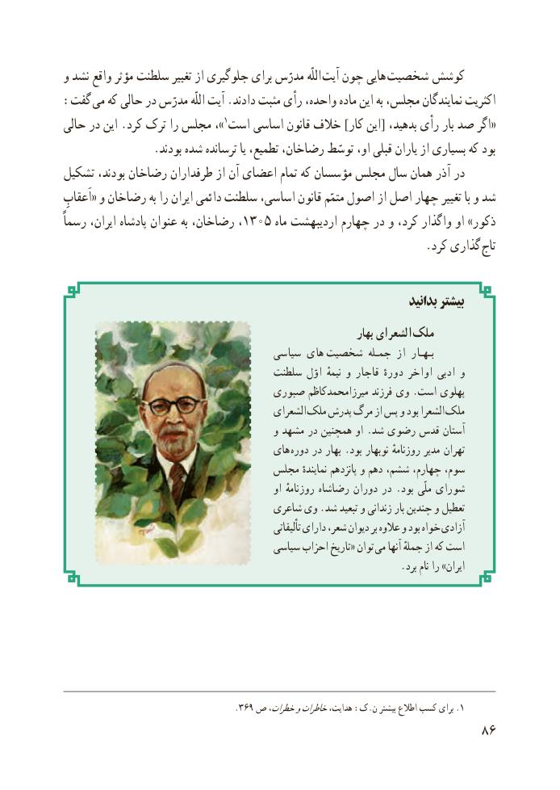

# PDF page 94

و نشد واقع مؤثر سلطنت تغییر از جلوگیری برای مدرّس اللّه آیت چون هایی  شخصیت  کوشش
:گفت  می که حالی در مدرّس اللّه آیت .دادند مثبت رأی واحده، ماده این به مجلس، نمایندگان اکثریت
حالی در این .کرد ترک را مجلس ،» 1«است اساسی قانون خالف ]کار این[ بدهید، رأی بار صد اگر
                .بودند شده ترسانده یا تطمیع، رضاخان، توسّط او، قبلی یاران از بسیاری که بود
تشکیل بودند، رضاخان طرفداران از آن اعضای تمام که مؤسسان مجلس سال همان آذر در
اَعقابِ« و رضاخان به را ایران دائمی سلطنت اساسی، قانون متمّم اصول از اصل چهار تغییر با و شد
رسماً ایران، پادشاه عنوان به رضاخان، ،1305 ماه اردیبهشت چهارم در و کرد، واگذار او »ذکور
                                                                .کرد گذاری تاج

                                                                          بدانید بیشتر
                                                                      بهار الشعرای ملک
                                      سیاسی های  شخصیت جمـله از  بـهـار
                                     سلطنت اوّل نیمهٔ و قاجار دورهٔ اواخر ادبی و
                                  صبوری میرزامحمدکاظم فرزند وی .است پهلوی
                                             الشعرای ملک پدرش مرگ از پس و بود الشعرا ملک
                                           و مشهد در همچنین او .شد رضوی قدس آستان
                                       های دوره در بهار .بود نوبهار روزنامهٔ مدیر تهران
                                 مجلس نمایندهٔ پانزدهم و دهم ششم، چهارم، سوم،
                                                    او روزنامهٔ رضاشاه دوران در . بود ملّی شورای
                                     شاعری وی .شد تبعید و زندانی بار چندین و تعطیل
                                                             تألیفاتی دارای شعر، دیوان بر عالوه و بود خواه آزادی
                                       سیاسی احزاب تاریخ« توان  می آنها جملهٔ از که است
                                                                    .برد نام را »ایران

     .369  .ص خطرات،وخاطراتهدایت، :ک.ن بیشتر اطالع کسب برای 1
                                                           86

