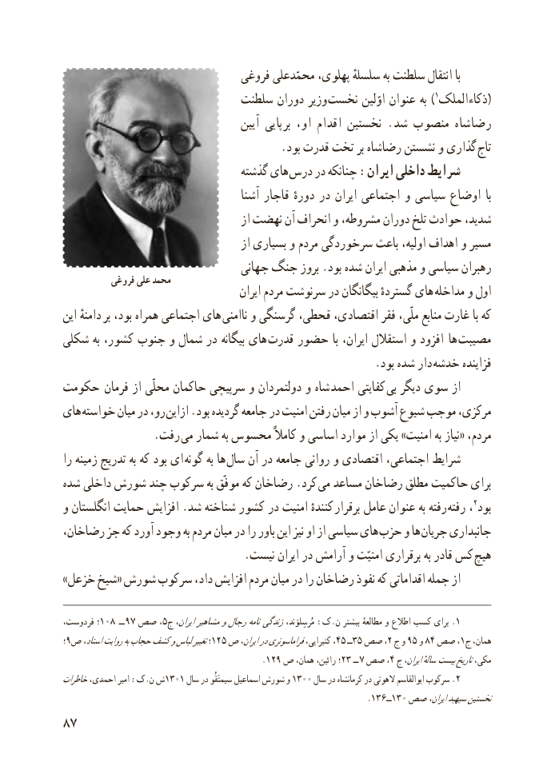

# PDF page 95

فروغی محمّدعلی پهلوی، سلسلهٔ به سلطنت انتقال با
                            سلطنت دوران وزیر )نخست اوّلین عنوان به  1الملک (ذکاء
                                        آیین برپایی او، اقدام نخستین . شد منصوب رضاشاه
  . بود قدرت تخت بر رضاشاه نشستن و گذاری تاج
                                 گذشته های درس در چنانکه :ایران داخلی شرایط
                                        آشنا قاجار دورهٔ در ایران اجتماعی و سیاسی اوضاع  با
                                        از نهضت آن انحراف و مشروطه، دوران تلخ حوادث شدید،
                                        از بسیاری و مردم سرخوردگی باعث اولیه، اهداف و مسیر
                                 جهانی جنگ بروز .بود شده ایران مذهبی و سیاسی رهبران           فروغی علی محمد
                                          ایران مردم سرنوشت در بیگانگان گستردهٔ های  مداخله و اول
 این دامنهٔ بر بود، همراه اجتماعی های  ناامنی و گرسنگی قحطی، اقتصادی، فقر ملّی، منابع غارت با که
شکلی به کشور، جنوب و شمال در بیگانه های قدرت حضور با ایران، استقالل و افزود   ها مصیبت
                                                        .بود شده دار خدشه فزاینده
حکومت  فرمان از محلّی حاکمان سرپیچی و دولتمردان و شاه احمد کفایتی بی دیگر سوی از
های خواسته میان در رو، ازاین .بود گردیده جامعه در امنیت رفتن میان از و آشوب شیوع موجب مرکزی،
                 .رفت می شمار به محسوس کامالً و اساسی موارد از یکی »امنیت به نیاز« مردم،
 را زمینه تدریج به که بود ای  گونه به ها  سال آن در جامعه روانی و اقتصادی اجتماعی، شرایط
شده داخلی شورش چند سرکوب به موفّق که رضاخان .کرد می مساعد رضاخان مطلق حاکمیت برای
و انگلستان حمایت افزایش .شد شناخته کشور در امنیت کنندهٔ  برقرار عامل عنوان به رفته رفته ،2بود
رضاخان، جز که آورد وجود به مردم میان در را باور این نیز او از سیاسی های حزب و ها جریان جانبداری
                                 .نیست ایران در آرامش و امنیّت برقراری به قادر کس هیچ
 »خزعل شیخ« شورش سرکوب داد، افزایش مردم میان در را رضاخان نفوذ که اقداماتی جمله از

،؛فردوست  108   ــ 97 صص ،5ج ایران،مشاهیرورجالنامه .زندگیمُرسِلوَند، :ک.ن بیشتر مطالعهٔ و اطالع کسب برای 1
 ؛9ص اسناد،روایتبهحجابکشفولباستغییر؛125 ص٤٥ایران،درفراماسونریکتیرایی، ،      ــ٣٥ صص٥٢، ج و ٩ و٨٤ صص ،1ج همان،
                                                  .129 ص همان، رائین، ؛23 ــ 7 صص ،4 ج ایران،سالهٔ  بیستتاریخمکی،
خاطراتاحمدی، امیر :ک.ن ش1301 سال در سیمتَقُو اسماعیل شورش و 1300 سال در کرمانشاه در الهوتی ابوالقاسم سرکوب .2
                                                                .136ــ130 صص ایران،سپهبدنخستین
87

